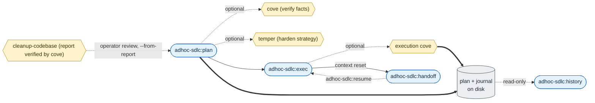

# adhoc-sdlc

*English · [Polski](README.pl.md)*

## What

`adhoc-sdlc` is a small SDLC toolkit for AI coding agents. It packages five reusable skills: `adhoc-sdlc` for lightweight implementation work with a durable plan and execution journal, `intention-hardening` for settling what the user actually asked for before a plan is written, `cove` for Chain-of-Verification before factual claims reach a user, `temper` for hardening a plan's strategy against failure modes before execution, and `cleanup-codebase` for an evidence-based assessment of what code can be cleaned up safely.

## Why

AI coding is fast, but speed without a record is fragile. This repo gives Claude Code and Codex a shared workflow for planning, verifying, journaling, resuming, and handing off small tasks without turning every change into a formal issue.

## Quick start

Install the plugin from the marketplace, then start a new session.

**Claude Code:**

```
/plugin marketplace add daniel-grabowski/adhoc-sdlc
/plugin install adhoc-sdlc@adhoc-sdlc
```

**Codex:**

```
codex plugin marketplace add daniel-grabowski/adhoc-sdlc --ref main
codex plugin add adhoc-sdlc@adhoc-sdlc
```

For local development against a checkout, source switching, and the Antigravity status, see [Install](#install) below.

## Harness, not vibe coding

Addy Osmani's [The New Software Lifecycle](https://addyosmani.com/blog/new-sdlc-vibe-coding/), and the [Google whitepaper](https://www.kaggle.com/whitepaper-the-new-SDLC-with-vibe-coding) behind it, frame an agent as a model plus a harness. The model is one input; the harness is the instructions, tools, context rules, and verification wrapped around it. The paper's rough split is 10% model, 90% harness. It also puts the line between vibe coding and engineering in one place: verification. Code that merely seems to work is vibe coding; code whose outputs get checked is engineering.

This repo is the harness, not the model. `adhoc-sdlc` is the record: a confirmed plan and a journal that outlive a pause or a context reset, so the work stays checkable instead of living only in a chat log. `cove` is the verification: it runs a draft through independent questions before any claim reaches you. `temper` is the pressure test: it hunts a plan's failure modes before they become code. The skills load the way the paper recommends too, a little metadata up front and the full instructions only once a task matches (progressive disclosure), so the context you pay for on every turn stays small.

None of that waits on a better model. It is configuration you can get right today, reviewed and versioned like the rest of the code.

## Skills

### adhoc-sdlc

What: a lightweight SDLC for small, ad hoc implementation work. Why: it keeps even quick fixes grounded in a confirmed plan, engineering checklist, optional verification gates, an execution task list defined in the plan and validated by the helper (no native todo tool needed, the same in Claude Code and Codex), and a resumable execution journal under `./adhoc-sdlc`. See [claude/skills/adhoc-sdlc/README.md](claude/skills/adhoc-sdlc/README.md) for details.

<p align="center">
  
</p>

### Intention hardening

What: a planning gate that hardens the user's intent: goal and success criterion, load-bearing terms with their project meaning and source, named interpretations, and one deciding question or explicit assumptions. Why: it catches a silently narrowed term or a widened scope before the plan is accepted, ahead of `cove` and `temper`. It ships as the `intention-hardening` skill, called by `/adhoc-sdlc:plan` and by FORGE `/forge init`, whose init guide also calls `cove` and `temper` and stops with an explicit message when the plugin or a skill of an enabled mode is missing, and continues only with the operator's consent. See [claude/skills/intention-hardening/README.md](claude/skills/intention-hardening/README.md) for details.

### CoVe

What: Chain-of-Verification for factual work. Why: it forces drafts through independent verification questions so final answers keep only verified or explicitly caveated facts. The Claude Code and Codex plugins ship this as the `cove` skill. See [claude/skills/cove/README.md](claude/skills/cove/README.md) for details.

### Temper

What: strategy hardening for plans, architecture, and implementation direction. Why: it runs a focused failure-mode pass after factual verification and before execution, so loopholes are fixed or explicitly accepted before they become code. It ships as the `temper` skill and as the `strategy-temper` gate inside `/adhoc-sdlc:plan`. See [claude/skills/temper/README.md](claude/skills/temper/README.md) for details.

### Cleanup codebase

What: an evidence-based cleanup assessment for a given goal and scope: dead code, equivalent implementations, unneeded dependencies, and leftovers of changes, each checked against the categories of implicit entry points and given one verdict and a stable ID (`remove` R1, `merge` M1, `keep` K1, `unresolved` U1). Why: an empty search is not proof that code is unused, and **cleaning up without fact verification costs far more than verifying first**: removing something that worked through an invisible entry point costs an outage, a diagnosis, and a restore. So the skill splits the scope into areas and has the claims behind every verdict verified by `cove`, for every candidate; no `remove` or `merge` verdict exists without that check.

The skill only assesses: it does not change the project's code, run git, build, or run tests; its only effect is the report. In Claude Code the report is by default an interactive artifact that doubles as the review form (description, explanation, radio buttons with the recommendation preselected, notes, autosave), so the agent reads the operator's decisions per ID straight from it; in Codex it is a Markdown file. The loop then closes through adhoc-sdlc: operator review (their knowledge can reverse a verdict) -> `/adhoc-sdlc:plan --from-report <report> --ids R1,M1` (the plan records the report's SHA-256 and each task's `ref` to its ID) -> `exec` (hash check, evidence re-check per item) -> a journal that shows what was done and which report item it came from. It also ships as the optional `cleanup-codebase` mode of `/adhoc-sdlc:plan` (off by default): during planning it assesses the plan's scope, and at the end of `exec` the leftovers of the change, which are cleaned up only after the user confirms. See [claude/skills/cleanup-codebase/README.md](claude/skills/cleanup-codebase/README.md) for details.

## How it fits together

The skills are one workflow: settle the intent, plan the change, verify the facts it rests on, harden the strategy, then execute the plan's task list with a journal you can resume or hand off. `cove`, `temper`, and `cleanup-codebase` are optional gates, chosen per task in the plan's mode list.



Shapes carry the meaning: rounded is a command, a hexagon is an optional gate (`cove` and `temper` before the plan is saved, execution `cove` before execution closes, and a reviewed `cleanup-codebase` report as the input of a plan), and the cylinder is the on-disk record. Solid edges are the main flow, dotted edges are optional or read-only, and thick edges write to the plan and journal that outlive a context reset, which is what `handoff` and `resume` bridge.

## Research basis

The `cove` skill is an implementation and adaptation of Chain-of-Verification (CoVe), a method introduced by Dhuliawala et al. The model drafts an answer, plans independent verification questions, answers them without leaning on the draft, and writes a final response that keeps only what held up. This repo adapts that loop to the sources of truth an agent actually has: repository code, plans, execution journals, command output, tests, documentation, and issue trackers.

> Shehzaad Dhuliawala, Mojtaba Komeili, Jing Xu, Roberta Raileanu, Xian Li, Asli Celikyilmaz, and Jason Weston. 2024. [Chain-of-Verification Reduces Hallucination in Large Language Models](https://aclanthology.org/2024.findings-acl.212/). In *Findings of the Association for Computational Linguistics: ACL 2024*, pages 3563-3578. DOI: [10.18653/v1/2024.findings-acl.212](https://doi.org/10.18653/v1/2024.findings-acl.212).

`cove` adapts that method; it does not claim to originate it. `temper` and `adhoc-sdlc` are original to this repo and do not derive from a single source paper. This project is not affiliated with or endorsed by the paper's authors or the ACL.

## Layout

One directory per agent runtime, each packaged in that runtime's native format. The Python helper is shared across variants and duplicated where plugin packaging requires a self-contained directory.

```
.claude-plugin/marketplace.json   Claude Code marketplace entry
.agents/plugins/marketplace.json  Codex marketplace entry
claude/                           Claude Code plugin: adhoc-sdlc + intention-hardening + cove + temper + cleanup-codebase
  .claude-plugin/plugin.json
  skills/adhoc-sdlc/
  skills/intention-hardening/
  skills/cove/
  skills/temper/
  skills/cleanup-codebase/
  commands/                       /adhoc-sdlc:plan :exec :handoff :resume :history
plugins/adhoc-sdlc/            Codex plugin: adhoc-sdlc + intention-hardening + cove + temper + cleanup-codebase
  .codex-plugin/plugin.json
  skills/adhoc-sdlc/
  skills/intention-hardening/
  skills/cove/
  skills/temper/
  skills/cleanup-codebase/
antigravity/                      roadmap: extension format to be confirmed
```

In Claude Code the commands live in a top-level `commands/` tree (namespaced by the plugin to `/adhoc-sdlc:*`); in Codex they live inside the skill. The Claude variant references scripts through `${CLAUDE_PLUGIN_ROOT}`; the Codex variant resolves scripts relative to the installed skill directory.

## Install

### Claude Code (plugin)

From the marketplace:

```
/plugin marketplace add daniel-grabowski/adhoc-sdlc
/plugin install adhoc-sdlc@adhoc-sdlc
```

For local development against a checkout, load the plugin directory directly:

```
claude --plugin-dir ./claude
```

### Codex (plugin)

Recommended public install from GitHub:

```
codex plugin marketplace add daniel-grabowski/adhoc-sdlc --ref main
codex plugin add adhoc-sdlc@adhoc-sdlc
```

This does not use your local checkout. Codex fetches the `adhoc-sdlc` marketplace from GitHub, then resolves the plugin through `.agents/plugins/marketplace.json` inside that fetched repo. The marketplace entry intentionally uses a relative local path:

```json
"source": {
  "source": "local",
  "path": "./plugins/adhoc-sdlc"
}
```

That path is local to the downloaded marketplace snapshot, not to `/home/.../adhoc-sdlc` on your machine.

If you previously added the marketplace from a local checkout, switch it to GitHub:

```
codex plugin remove adhoc-sdlc@adhoc-sdlc
codex plugin marketplace remove adhoc-sdlc
codex plugin marketplace add daniel-grabowski/adhoc-sdlc --ref main
codex plugin add adhoc-sdlc@adhoc-sdlc
```

Verify the source:

```
codex plugin marketplace list --json
codex plugin list --marketplace adhoc-sdlc --available --json
```

For local development against a checkout:

```
codex plugin marketplace add .
codex plugin add adhoc-sdlc@adhoc-sdlc
```

### Antigravity CLI

Planned, most likely as a skill like the Codex variant rather than a plugin. The exact format is not finalized here yet; see [antigravity/README.md](antigravity/README.md) for the current status.

## License

Apache-2.0. See [LICENSE](LICENSE) and [NOTICE](NOTICE).

## Author

Daniel Grabowski <daniel.grabowski@faktoria.io>
