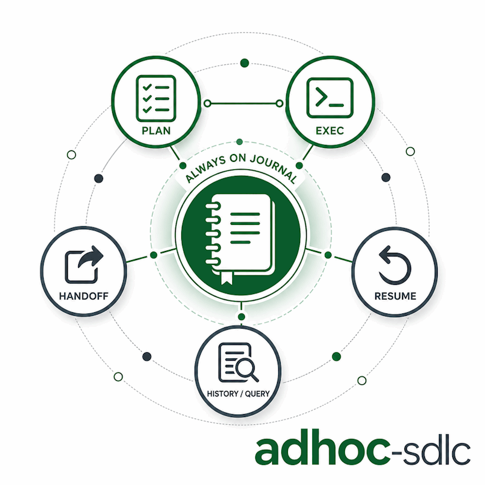

# faktoria-sdlc

*English · [Polski](README.pl.md)*

SDLC skills for AI coding agents: plan, keep a resumable execution journal, and hand off work between sessions. Packaged as Claude Code and Codex plugins, with a plain Codex skill kept for compatibility and an Antigravity CLI extension on the roadmap.

## Skills

### adhoc-sdlc

A lightweight SDLC for small, ad hoc work: too small for a formal issue, but worth a durable plan and a resumable execution history. It produces a confirmed plan and an incremental execution journal under `./adhoc-sdlc` in the project you run it in. See [claude/skills/adhoc-sdlc/README.md](claude/skills/adhoc-sdlc/README.md) for details.

<p align="center">
  
</p>

### CoVe

Chain-of-Verification for factual work: draft an answer, plan independent verification questions, verify claims, and revise the final answer with only verified or explicitly caveated facts. The Claude Code and Codex plugins ship this as the `cove` skill.

## Layout

One directory per agent runtime, each packaged in that runtime's native format. The Python helper is shared across variants and duplicated where plugin packaging requires a self-contained directory.

```
.claude-plugin/marketplace.json   Claude Code marketplace entry
.agents/plugins/marketplace.json  Codex marketplace entry
claude/                           Claude Code plugin: adhoc-sdlc + cove
  .claude-plugin/plugin.json
  skills/adhoc-sdlc/
  skills/cove/
  commands/                       /adhoc-sdlc:plan :exec :handoff :resume :history
plugins/faktoria-sdlc/            Codex plugin: faktoria-sdlc
  .codex-plugin/plugin.json
  skills/adhoc-sdlc/
  skills/cove/
codex/                            Codex skill (cp -r install)
  skills/adhoc-sdlc/
antigravity/                      roadmap: extension format to be confirmed
```

In Claude Code the commands live in a top-level `commands/` tree (namespaced by the plugin to `/adhoc-sdlc:*`); in Codex they live inside the skill. The Claude variant references scripts through `${CLAUDE_PLUGIN_ROOT}`; the Codex variant resolves scripts relative to the installed skill directory.

## Install

### Claude Code (plugin)

From the marketplace:

```
/plugin marketplace add daniel-grabowski/faktoria-sdlc
/plugin install adhoc-sdlc@faktoria-sdlc
```

For local development against a checkout, load the plugin directory directly:

```
claude --plugin-dir ./claude
```

### Codex (plugin)

Recommended public install from GitHub:

```
codex plugin marketplace add daniel-grabowski/faktoria-sdlc --ref main
codex plugin add faktoria-sdlc@faktoria-sdlc
```

This does not use your local checkout. Codex fetches the `faktoria-sdlc` marketplace from GitHub, then resolves the plugin through `.agents/plugins/marketplace.json` inside that fetched repo. The marketplace entry intentionally uses a relative local path:

```json
"source": {
  "source": "local",
  "path": "./plugins/faktoria-sdlc"
}
```

That path is local to the downloaded marketplace snapshot, not to `/home/.../faktoria-sdlc` on your machine.

If you previously added the marketplace from a local checkout, switch it to GitHub:

```
codex plugin remove faktoria-sdlc@faktoria-sdlc
codex plugin marketplace remove faktoria-sdlc
codex plugin marketplace add daniel-grabowski/faktoria-sdlc --ref main
codex plugin add faktoria-sdlc@faktoria-sdlc
```

Verify the source:

```
codex plugin marketplace list --json
codex plugin list --marketplace faktoria-sdlc --available --json
```

For local development against a checkout:

```
codex plugin marketplace add .
codex plugin add faktoria-sdlc@faktoria-sdlc
```

### Codex (plain skill compatibility)

If you need the legacy plain-skill install instead of the plugin:

```
cp -r codex/skills/adhoc-sdlc ~/.codex/skills/
```

Then reload skills in your agent.

### Antigravity CLI

Planned, most likely as a skill like the Codex variant rather than a plugin. The exact format is not finalized here yet; see [antigravity/README.md](antigravity/README.md) for the current status.

## License

MIT. See [LICENSE](LICENSE).

## Author

Daniel Grabowski <daniel.grabowski@faktoria.io>
