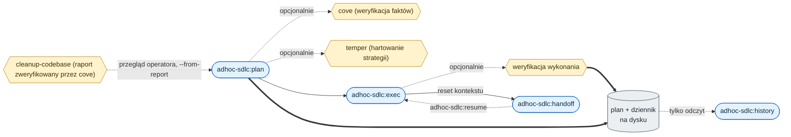

# adhoc-sdlc

*[English](README.md) · Polski*

## Co to jest

`adhoc-sdlc` to mały zestaw SDLC dla agentów programujących AI. Dostarcza siedem skilli: `adhoc-sdlc` do lekkiej pracy implementacyjnej z trwałym planem i dziennikiem wykonania, `intention-hardening` do ustalenia, o co naprawdę prosi użytkownik, zanim powstanie plan, `cove` do Chain-of-Verification przed wypuszczeniem twierdzeń faktograficznych do użytkownika, `temper` do hartowania strategii planu pod kątem trybów awarii przed wykonaniem `cleanup-codebase` do opartej na dowodach oceny, co w kodzie można bezpiecznie uporządkować, `debug` do systematycznego szukania przyczyny źródłowej błędów oraz `tdd` do programowania sterowanego testami.

## Dlaczego

AI potrafi kodować szybko, ale szybkość bez zapisu decyzji jest krucha. To repo daje Claude Code i Codex wspólny workflow do planowania, weryfikacji, zarządzania dziennikiem prac, wznawiania i przekazywania małych zadań bez zamieniania każdej zmiany w formalne issue.

## Szybki start

Zainstaluj plugin z marketplace, potem zacznij nową sesję.

**Claude Code:**

```
/plugin marketplace add daniel-grabowski/adhoc-sdlc
/plugin install adhoc-sdlc@adhoc-sdlc
```

**Codex:**

```
codex plugin marketplace add daniel-grabowski/adhoc-sdlc --ref main
codex plugin add adhoc-sdlc@adhoc-sdlc
```

Po pełne opcje (praca lokalna na checkoucie, przełączanie źródła, status Antigravity) zajrzyj do sekcji [Instalacja](#instalacja) niżej.

## Harness, nie vibe-coding

Artykuł Addy'ego Osmaniego [The New Software Lifecycle](https://addyosmani.com/blog/new-sdlc-vibe-coding/) i stojący za nim [whitepaper Google](https://www.kaggle.com/whitepaper-the-new-SDLC-with-vibe-coding) ujmują agenta jako model plus harness. Model to jedno wejście; harness to instrukcje, narzędzia, reguły kontekstu i weryfikacja owinięte wokół niego. Zgrubny podział z artykułu to 10% model, 90% harness. Ten sam tekst stawia linię między vibe-codingiem a inżynierią w jednym miejscu: przy weryfikacji. Kod, który tylko wygląda na działający, to vibe-coding; kod, którego wyniki są sprawdzane, to inżynieria.

To repo jest harnessem, nie modelem. `adhoc-sdlc` to zapis: potwierdzony plan i dziennik, które przeżywają pauzę albo reset kontekstu, więc praca zostaje sprawdzalna, zamiast istnieć tylko w logu czatu. `cove` to weryfikacja: przepuszcza szkic przez niezależne pytania, zanim jakiekolwiek twierdzenie trafi do Ciebie. `temper` to próba wytrzymałości: poluje na tryby awarii planu, zanim staną się kodem. Skille ładują się też tak, jak zaleca artykuł: trochę metadanych z góry, a pełne instrukcje dopiero, gdy zadanie pasuje (progressive disclosure), więc kontekst, za który płacisz w każdej turze, zostaje mały.

Nic z tego nie czeka na lepszy model. To konfiguracja, którą możesz dopiąć już dziś, recenzowana i wersjonowana jak reszta kodu.

## Skille

### adhoc-sdlc

Co to jest: lekki cykl SDLC dla małej, doraźnej pracy implementacyjnej. 

#### Dlaczego

Nawet szybka poprawka ma mieć potwierdzony plan, checklistę inżynierską, opcjonalne bramy weryfikacyjne, listę zadań wykonania zdefiniowaną w planie i walidowaną przez helper (bez natywnego narzędzia listy zadań, tak samo w Claude Code i Codex) oraz wznawialny dziennik wykonania pod `./adhoc-sdlc`. Szczegóły w [claude/skills/adhoc-sdlc/README.pl.md](claude/skills/adhoc-sdlc/README.pl.md).

<p align="center">
  
</p>

### Intention hardening

#### Po co?

Bramka planowania, która utwardza zamiar użytkownika: cel i kryterium sukcesu, pojęcia nośne ze znaczeniem w projekcie i źródłem, nazwane interpretacje oraz jedno rozstrzygające pytanie albo jawne założenia.

#### Dlaczego

Wychwytuje po cichu zawężone pojęcie albo poszerzony zakres, zanim plan zostanie zaakceptowany, przed `cove` i `temper`. Dostarczany jako skill `intention-hardening`, wołany przez `/adhoc-sdlc:plan` i przez `/forge init` w FORGE, którego przewodnik init woła też `cove` i `temper`, a bez pluginu albo gdy brakuje skilla włączonego trybu zatrzymuje się z jawnym komunikatem, a dalej idzie tylko za zgodą operatora. Szczegóły w [claude/skills/intention-hardening/README.pl.md](claude/skills/intention-hardening/README.pl.md).

### CoVe

#### Po co? 

Chain-of-Verification do pracy faktograficznej. 

#### Dlaczego 

Wymusza przejście od szkicu przez niezależne pytania weryfikacyjne, żeby finalna odpowiedź zawierała tylko fakty potwierdzone albo jawnie oznaczone jako niepewne. 
Pluginy Claude Code i Codex dostarczają to jako skill `cove`. Szczegóły w [claude/skills/cove/README.pl.md](claude/skills/cove/README.pl.md).

### Temper

#### Po co?

Hartowanie strategii planu, architektury i kierunku implementacji.

#### Dlaczego

Uruchamia skoncentrowany przebieg trybów awarii po weryfikacji faktów, a przed wykonaniem, żeby luki zostały zamknięte albo świadomie zaakceptowane, zanim staną się kodem. Dostarczany jako skill `temper` oraz jako bramka `strategy-temper` w `/adhoc-sdlc:plan`. Szczegóły w [claude/skills/temper/README.pl.md](claude/skills/temper/README.pl.md).

### Cleanup codebase

#### Po co?

Oparta na dowodach ocena porządków dla podanego celu i zakresu: martwy kod, równoważne implementacje, zbędne zależności i pozostałości zmian, każdy kandydat sprawdzony pod kątem kategorii niejawnych punktów wejścia, z jednym werdyktem i stałym identyfikatorem (`remove` R1, `merge` M1, `keep` K1, `unresolved` U1).

#### Dlaczego

Puste wyszukiwanie nie dowodzi, że kod jest nieużywany, a **sprzątanie kodu bez analizy faktograficznej jest wielokrotnie droższe niż weryfikacja**: usunięcie czegoś, co działało przez niewidoczny punkt wejścia, kosztuje awarię, diagnozę i przywracanie. Dlatego skill dzieli zakres na obszary i zleca weryfikację twierdzeń stojących za każdym werdyktem skillowi `cove`, dla każdego kandydata; bez tej weryfikacji nie ma werdyktu `remove` ani `merge`.

Skill tylko ocenia: nie zmienia kodu projektu, nie wykonuje git, nie buduje i nie uruchamia testów; jedynym skutkiem jest raport. W Claude Code raport jest domyślnie interaktywnym artefaktem, który służy też jako formularz przeglądu (opis, wyjaśnienie, przyciski opcji z zaznaczoną rekomendacją, uwagi, autozapis), więc agent odczytuje decyzje operatora dla każdego ID wprost z niego; w Codexie jest plikiem Markdown. Pętlę domyka adhoc-sdlc: przegląd operatora (jego wiedza może odwrócić werdykt) -> `/adhoc-sdlc:plan --from-report <raport> --ids R1,M1` (plan zapisuje skrót SHA-256 raportu i odwołanie `ref` każdego zadania do jego ID) -> `exec` (kontrola skrótu, ponowne sprawdzenie każdej pozycji) -> dziennik, który pokazuje, co wykonano i z której pozycji raportu. Skill działa też jako opcjonalny tryb `cleanup-codebase` w `/adhoc-sdlc:plan` (domyślnie wyłączony): w planowaniu ocenia zakres planu, a na końcu `exec` pozostałości zmiany, które są usuwane dopiero po potwierdzeniu użytkownika. Szczegóły w [claude/skills/cleanup-codebase/README.pl.md](claude/skills/cleanup-codebase/README.pl.md).

## Jak to działa razem

Skille to jeden przepływ: ustal intencję, zaplanuj zmianę, zweryfikuj fakty, na których się opiera, zahartuj strategię, a potem wykonaj listę zadań planu z dziennikiem, który da się wznowić albo przekazać. `cove`, `temper` i `cleanup-codebase` to bramki opcjonalne, wybierane per zadanie na liście trybów planu.



Znaczenie niosą kształty: zaokrąglony to komenda, sześciokąt to opcjonalna bramka (`cove` i `temper` przed zapisem planu, `cove` wykonania przed zamknięciem wykonania oraz przejrzany raport `cleanup-codebase` jako wejście planu), a walec to zapis na dysku. Krawędzie ciągłe to główny przepływ, kropkowane to opcjonalne albo tylko do odczytu, a grube zapisują plan i dziennik, które przeżywają reset kontekstu. Ten most budują `handoff` i `resume`.

## Podstawa badawcza

Skill `cove` to implementacja i adaptacja Chain-of-Verification (CoVe), metody wprowadzonej przez Dhuliawalę i in. Model pisze szkic odpowiedzi, planuje niezależne pytania weryfikacyjne, odpowiada na nie bez opierania się na szkicu i tworzy finalną odpowiedź, która zostawia tylko to, co się obroniło. To repo przenosi tę pętlę na źródła prawdy, które agent faktycznie ma: kod repozytorium, plany, dzienniki wykonania, wyjście komend, testy, dokumentację i trackery zadań.

> Shehzaad Dhuliawala, Mojtaba Komeili, Jing Xu, Roberta Raileanu, Xian Li, Asli Celikyilmaz, and Jason Weston. 2024. [Chain-of-Verification Reduces Hallucination in Large Language Models](https://aclanthology.org/2024.findings-acl.212/). In *Findings of the Association for Computational Linguistics: ACL 2024*, pages 3563-3578. DOI: [10.18653/v1/2024.findings-acl.212](https://doi.org/10.18653/v1/2024.findings-acl.212).

`cove` adaptuje tę metodę, nie rości sobie jej autorstwa. `temper` i `adhoc-sdlc` są oryginalne dla tego repo i nie wywodzą się z jednego artykułu. Ten projekt nie jest powiązany z autorami pracy ani z ACL i nie jest przez nich firmowany.

## Układ

Jeden katalog na środowisko agenta, każdy spakowany w natywnym formacie tego środowiska. Helper w Pythonie jest wspólny dla wariantów i zduplikowany tam, gdzie plugin musi być samowystarczalnym katalogiem.

```
.claude-plugin/marketplace.json   wpis marketplace Claude Code
.agents/plugins/marketplace.json  wpis marketplace Codex
claude/                           plugin Claude Code: adhoc-sdlc + intention-hardening + cove + temper + cleanup-codebase + debug + tdd
  .claude-plugin/plugin.json
  skills/adhoc-sdlc/
  skills/intention-hardening/
  skills/cove/
  skills/temper/
  skills/cleanup-codebase/
  skills/debug/
  skills/tdd/
  commands/                       /adhoc-sdlc:plan :exec :handoff :resume :history
plugins/adhoc-sdlc/            plugin Codex: adhoc-sdlc + intention-hardening + cove + temper + cleanup-codebase + debug + tdd
  .codex-plugin/plugin.json
  skills/adhoc-sdlc/
  skills/intention-hardening/
  skills/cove/
  skills/temper/
  skills/cleanup-codebase/
  skills/debug/
  skills/tdd/
antigravity/                      plany: format rozszerzenia do ustalenia
```

W Claude Code komendy leżą w osobnym drzewie `commands/` (z namespace pluginu `/adhoc-sdlc:*`); w Codex leżą wewnątrz skilla. Wariant Claude wskazuje skrypty przez `${CLAUDE_PLUGIN_ROOT}`, a wariant Codex rozwiązuje skrypty względem katalogu zainstalowanego skilla.

## Instalacja

### Claude Code (plugin)

Z marketplace:

```
/plugin marketplace add daniel-grabowski/adhoc-sdlc
/plugin install adhoc-sdlc@adhoc-sdlc
```

Do lokalnej pracy na checkoucie załaduj katalog pluginu wprost:

```
claude --plugin-dir ./claude
```

### Codex (plugin)

Zalecana publiczna instalacja z GitHuba:

```
codex plugin marketplace add daniel-grabowski/adhoc-sdlc --ref main
codex plugin add adhoc-sdlc@adhoc-sdlc
```

To nie używa lokalnego checkoutu. Codex pobiera marketplace `adhoc-sdlc` z GitHuba, a potem rozwiązuje plugin przez `.agents/plugins/marketplace.json` z pobranego repo. Wpis marketplace celowo używa relatywnej ścieżki lokalnej:

```json
"source": {
  "source": "local",
  "path": "./plugins/adhoc-sdlc"
}
```

Ta ścieżka jest lokalna względem pobranej migawki marketplace, nie względem `/home/.../adhoc-sdlc` na Twojej maszynie.

Jeśli wcześniej dodałeś marketplace z lokalnego checkoutu, przełącz go na GitHub:

```
codex plugin remove adhoc-sdlc@adhoc-sdlc
codex plugin marketplace remove adhoc-sdlc
codex plugin marketplace add daniel-grabowski/adhoc-sdlc --ref main
codex plugin add adhoc-sdlc@adhoc-sdlc
```

Sprawdzenie źródła:

```
codex plugin marketplace list --json
codex plugin list --marketplace adhoc-sdlc --available --json
```

Do lokalnej pracy na checkoucie:

```
codex plugin marketplace add .
codex plugin add adhoc-sdlc@adhoc-sdlc
```

### Antigravity CLI

W planach, najpewniej jako skill (jak wariant Codex), nie plugin. Dokładny format nie został tu jeszcze ustalony; aktualny status w [antigravity/README.md](antigravity/README.md).

## Licencja

Apache-2.0. Zobacz [LICENSE](LICENSE) i [NOTICE](NOTICE).

## Autor

Daniel Grabowski <daniel.grabowski@faktoria.io>
