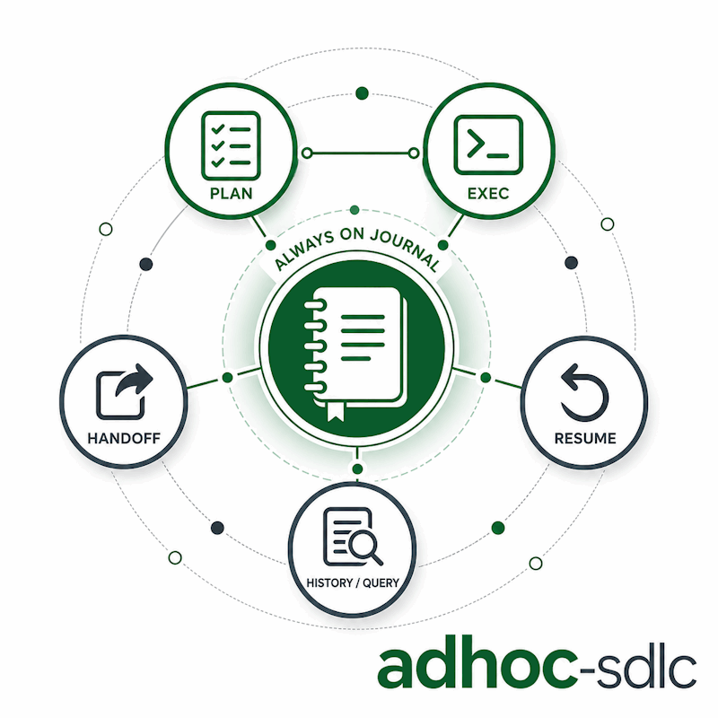

# faktoria-sdlc

*[English](README.md) · Polski*

## Co to jest

`faktoria-sdlc` to mały zestaw SDLC dla agentów programujących AI. Dostarcza dwa skille: `adhoc-sdlc` do lekkiej pracy implementacyjnej z trwałym planem i dziennikiem wykonania oraz `cove` do Chain-of-Verification przed wypuszczeniem twierdzeń faktograficznych do użytkownika.

## Dlaczego

AI koduje szybko, ale szybkość bez zapisu decyzji jest krucha. To repo daje Claude Code i Codex wspólny workflow do planowania, weryfikacji, dziennikowania, wznawiania i przekazywania małych zadań bez zamieniania każdej zmiany w formalne issue.

## Skille

### adhoc-sdlc

Co to jest: lekki cykl SDLC dla małej, doraźnej pracy implementacyjnej. Dlaczego: nawet szybka poprawka ma mieć potwierdzony plan, checklistę inżynierską, opcjonalne bramy weryfikacyjne i wznawialny dziennik wykonania pod `./adhoc-sdlc`. Szczegóły w [claude/skills/adhoc-sdlc/README.pl.md](claude/skills/adhoc-sdlc/README.pl.md).

<p align="center">
  
</p>

### CoVe

Co to jest: Chain-of-Verification do pracy faktograficznej. Dlaczego: wymusza przejście od szkicu przez niezależne pytania weryfikacyjne, żeby finalna odpowiedź zawierała tylko fakty potwierdzone albo jawnie oznaczone jako niepewne. Pluginy Claude Code i Codex dostarczają to jako skill `cove`.

## Układ

Jeden katalog na środowisko agenta, każdy spakowany w natywnym formacie tego środowiska. Helper w Pythonie jest wspólny dla wariantów i zduplikowany tam, gdzie plugin musi być samowystarczalnym katalogiem.

```
.claude-plugin/marketplace.json   wpis marketplace Claude Code
.agents/plugins/marketplace.json  wpis marketplace Codex
claude/                           plugin Claude Code: adhoc-sdlc + cove
  .claude-plugin/plugin.json
  skills/adhoc-sdlc/
  skills/cove/
  commands/                       /adhoc-sdlc:plan :exec :handoff :resume :history
plugins/faktoria-sdlc/            plugin Codex: faktoria-sdlc
  .codex-plugin/plugin.json
  skills/adhoc-sdlc/
  skills/cove/
codex/                            skill Codex (instalacja cp -r, kompatybilność)
  skills/adhoc-sdlc/
antigravity/                      plany: format rozszerzenia do ustalenia
```

W Claude Code komendy leżą w osobnym drzewie `commands/` (z namespace pluginu `/adhoc-sdlc:*`); w Codex leżą wewnątrz skilla. Wariant Claude wskazuje skrypty przez `${CLAUDE_PLUGIN_ROOT}`, a wariant Codex rozwiązuje skrypty względem katalogu zainstalowanego skilla.

## Instalacja

### Claude Code (plugin)

Z marketplace:

```
/plugin marketplace add daniel-grabowski/faktoria-sdlc
/plugin install adhoc-sdlc@faktoria-sdlc
```

Do lokalnej pracy na checkoucie załaduj katalog pluginu wprost:

```
claude --plugin-dir ./claude
```

### Codex (plugin)

Zalecana publiczna instalacja z GitHuba:

```
codex plugin marketplace add daniel-grabowski/faktoria-sdlc --ref main
codex plugin add faktoria-sdlc@faktoria-sdlc
```

To nie używa lokalnego checkoutu. Codex pobiera marketplace `faktoria-sdlc` z GitHuba, a potem rozwiązuje plugin przez `.agents/plugins/marketplace.json` z pobranego repo. Wpis marketplace celowo używa relatywnej ścieżki lokalnej:

```json
"source": {
  "source": "local",
  "path": "./plugins/faktoria-sdlc"
}
```

Ta ścieżka jest lokalna względem pobranej migawki marketplace, nie względem `/home/.../faktoria-sdlc` na Twojej maszynie.

Jeśli wcześniej dodałeś marketplace z lokalnego checkoutu, przełącz go na GitHub:

```
codex plugin remove faktoria-sdlc@faktoria-sdlc
codex plugin marketplace remove faktoria-sdlc
codex plugin marketplace add daniel-grabowski/faktoria-sdlc --ref main
codex plugin add faktoria-sdlc@faktoria-sdlc
```

Sprawdzenie źródła:

```
codex plugin marketplace list --json
codex plugin list --marketplace faktoria-sdlc --available --json
```

Do lokalnej pracy na checkoucie:

```
codex plugin marketplace add .
codex plugin add faktoria-sdlc@faktoria-sdlc
```

### Codex (kompatybilny plain skill)

Jeśli potrzebujesz starej instalacji jako plain skill zamiast pluginu:

```
cp -r codex/skills/adhoc-sdlc ~/.codex/skills/
```

Następnie przeładuj skille w swoim agencie.

### Antigravity CLI

W planach, najpewniej jako skill (jak wariant Codex), nie plugin. Dokładny format nie został tu jeszcze ustalony; aktualny status w [antigravity/README.md](antigravity/README.md).

## Licencja

MIT. Zobacz [LICENSE](LICENSE).

## Autor

Daniel Grabowski <daniel.grabowski@faktoria.io>
