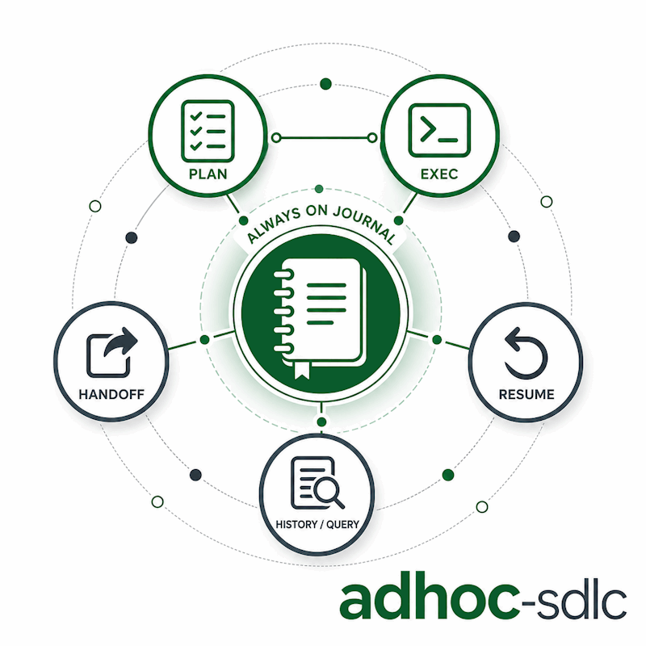

<p align="center">
  
</p>

# adhoc-sdlc

*[English](README.md) · Polski*

## Co to jest

`adhoc-sdlc` to lekki cykl SDLC dla małej pracy implementacyjnej w bieżącym projekcie: za małej na formalny issue, ale na tyle ważnej, żeby miała prawdziwy plan i wznawialną historię wykonania.

## Dlaczego

Doraźna praca programistyczna często psuje się przez utratę kontekstu: co było zaplanowane, co zmieniono, co zweryfikowano i co jeszcze zostało. Ten skill zapisuje ten ślad na dysku, żeby agent mógł bezpiecznie kontynuować po pauzie, przekazaniu pracy albo resecie kontekstu.

## Do czego służy

Skill zamienia szybkie zlecenie w dwa śledzone artefakty pod `./adhoc-sdlc`:

- potwierdzony plan (`plan-*.md`),
- przyrostowy dziennik wykonania (`execute-*.json`), który zapisuje, co zmieniłeś, co zweryfikowałeś i co zostało.

Oboma plikami zarządza pomocniczy skrypt w Pythonie, więc zapis pozostaje spójny, a sesję można później wznowić z samego dysku.

## Kiedy używać

Sięgaj po niego, gdy zadanie to realna praca implementacyjna, ale nie uzasadnia formalnego issue:

- doraźne poprawki,
- szybkie funkcje,
- refaktory, które chcesz zaplanować i zalogować.

Pomiń go, gdy praca należy już do formalnego przepływu issue z własnym źródłem prawdy, albo gdy to tylko pytanie bez implementacji.

## Komendy

| Komenda | Rola |
|---------|------|
| `/adhoc-sdlc:plan` | ustal decyzje projektowe i zapisz potwierdzony plan |
| `/adhoc-sdlc:exec` | wykonaj plan i prowadź dziennik wykonania |
| `/adhoc-sdlc:handoff` | zrób snapshot stanu sesji przed przełączeniem kontekstu |
| `/adhoc-sdlc:resume` | wczytaj jedną z ostatnich sesji i kontynuuj |
| `/adhoc-sdlc:history` | przeanalizuj wcześniejsze sesje pod zadanym kątem (tylko odczyt) |

## Jak przebiega sesja

1. `plan` działa jak prowadzona rozmowa. Najpierw pyta, jak ma pracować (brama trybów Faza 0: dialog brainstorming, głęboka weryfikacja w kodzie, uruchamianie testów, plan CoVe, weryfikacja wykonania CoVe), potem ustala zakres, podejście, przypadki brzegowe i plan testów, i zapisuje plik planu.
2. `exec` zasiewa natywną listę zadań z planu, przechodzi przez nią i dopisuje wpis do dziennika po każdym istotnym kroku. Zawsze kończy końcową autokontrolą zapisaną w dzienniku.
3. `handoff` i `resume` przenoszą stan między oknami kontekstu: jeden robi snapshot, drugi go wczytuje i rusza od następnych kroków.
4. `history` czyta cały korpus przez helper, żeby odpowiedzieć na pytanie o wcześniejszą pracę.

## Pliki

```
adhoc-sdlc/
  SKILL.md       instrukcje dla agenta (źródło prawdy)
  reference.md   kontrakt plików: frontmatter, flagi helpera, operacje dziennika
  README.md      ten przegląd (po angielsku)
  README.pl.md   ten przegląd (po polsku)
  scripts/       helper w Pythonie (adhoc_sdlc.py) i jego testy
```

Plany i dzienniki trafiają do `./adhoc-sdlc/` w bieżącym projekcie, nie tutaj.

## Helper

`scripts/adhoc_sdlc.py` to jedyny zapisujący pliki `adhoc-sdlc/`. Wpisy w dzienniku zmieniają się tylko przez jego flagi (`--append`, `--decision`, `--verification`, `--final`), nigdy przez ręczną edycję pliku JSON. Przy `history`, `resume` i `handoff` ten sam helper (tryb `pack`) jest jedynym czytającym: wyszukuje, parsuje i budżetuje kontekst, a agent pracuje na zwróconej paczce, zamiast skanować pliki wprost.

## Język

Instrukcje w tym skillu są po angielsku i to jest źródło prawdy. Zachowanie dopasowuje się do rozmowy: tekst widoczny dla użytkownika idzie w jego języku, a identyfikatory maszynowe (nazwy semantyczne, nazwy plików) zostają w ASCII kebab-case.

## Więcej

Po instrukcje dla agenta zajrzyj do `SKILL.md`, a po pełny kontrakt plików do `reference.md`. Definicje komend leżą w katalogu `commands/` pluginu.

## Autor

Daniel Grabowski <daniel.grabowski@faktoria.io>
