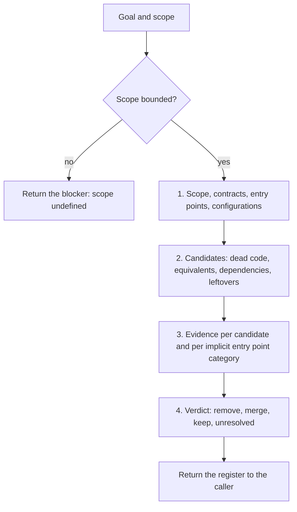

<!-- GENERATED by tools/render.py from templates/skills/cleanup-codebase/README.md + runtimes/claude.json. DO NOT EDIT here; edit the template and re-run tools/render.py. -->
# cleanup-codebase

*English · [Polski](README.pl.md)*

## What

`cleanup-codebase` is an evidence-based cleanup assessment. Given a goal and a
scope, it finds dead code, equivalent implementations, unneeded dependencies, and
leftovers of changes, checks each candidate against the categories of implicit
entry points, and returns a candidate register with one verdict per candidate:
`remove`, `merge`, `keep`, or `unresolved`.

## Why

Leftover and duplicated code raises the cost of every later change and loads the
agent's context, but removing it on the strength of an empty search is risky: code
can be reached by name from data, configuration, registrations, generated code, or
other repositories. The skill makes the decision repeatable and grounded in
evidence, so the process that edits files removes only what the evidence supports.

## What it is not

It does not edit files, run git, build, or run tests. It returns the register to
the caller: `exec` in adhoc-sdlc or the builder in a FORGE run applies the changes
under its own verification rules. It is stack-agnostic: how to check a category in
a given stack comes from the project's rules and skills.

## Process

1. Establish the scope, its contracts, entry points, and supported configurations.
2. Find candidates in the four groups.
3. Collect evidence for each candidate: search, reachability, tests,
   configuration, and every category of implicit entry points (dynamic calls and
   reflection, registrations, references by name in data, resources, and
   configuration, generated code, public API). No hits and green tests are never
   evidence on their own.
4. Give each candidate one verdict. A category that cannot be checked gives
   `unresolved`, never `remove`.

## Register

One row per candidate: location, verdict, evidence per category, risk, and reach
(files and dependencies), under the assessment date, goal, and scope. Findings
outside the scope are listed as proposals. A smaller install size is reported only
after measuring it.

## Where it sits

It runs on demand, through the optional `cleanup-codebase` mode of
`/adhoc-sdlc:plan` (the register feeds the plan and `exec`), or in FORGE, where the
register becomes the scope of a task. `cove` can verify the claims behind a verdict
and `temper` the cleanup strategy; neither replaces the analysis of the code.

## More detail

See `SKILL.md` for the agent-facing instructions, including the verdict rules and
the register format.

## Author

Daniel Grabowski <daniel.grabowski@faktoria.io>
