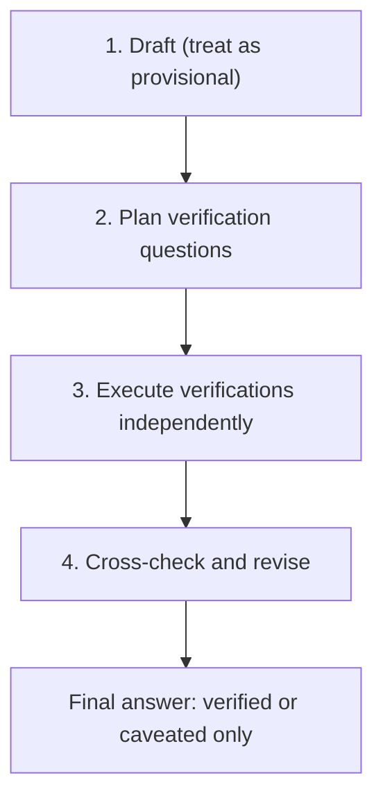

<!-- GENERATED by tools/render.py from templates/skills/cove/README.md + runtimes/claude.json. DO NOT EDIT here; edit the template and re-run tools/render.py. -->
# CoVe

*English · [Polski](README.pl.md)*

## What

`cove` is Chain-of-Verification for factual claims: draft an answer, ask
independent verification questions, answer them without leaning on the draft, and
revise the final answer to keep only what survived.

## Why

Use it when correctness matters more than speed. It reduces hallucinated or
overconfident claims by forcing the final answer to keep only verified facts or
explicit caveats. It suits answers, lists, summaries, audits, citations, and any
user-facing text where a wrong fact is expensive.

## Process

1. Draft a baseline answer and treat it as provisional, not as truth.
2. Write one open question per claim, each independently answerable.
3. Answer each question from the source of truth, without letting the draft anchor
   the answer; use external tools (web, repo, tests, docs, database) when the fact
   is current, high-stakes, or source-specific.
4. Mark each claim `CONSISTENT`, `INCONSISTENT`, or `INCONCLUSIVE`, then write the
   final answer using only verified or explicitly caveated claims.

## When to use it

Reach for it for lists ("name some X that Y"), biographies, and historical or
technical claims (timelines, versions, file paths, commands, exact error text).
For code generation and bug fixes, rely on tests and runtime checks; use CoVe only
for the factual claims around the code.

Prefer fewer verified facts over many uncertain ones, and avoid yes/no
verification questions, which encourage agreement bias.

## Evidence boundary

Do not overstate the source paper. The often-cited `~17% -> ~70%` figure is
specific to its Wikidata list task (Llama 65B), not a universal accuracy
guarantee; treat it as evidence that short, targeted verification exposes facts
missed in long-form generation. Primary source: Dhuliawala et al.,
"Chain-of-Verification Reduces Hallucination in Large Language Models",
Findings of ACL 2024, pages 3563-3578 (DOI 10.18653/v1/2024.findings-acl.212;
https://aclanthology.org/2024.findings-acl.212/; arXiv 2023). The paper does not
cover external tool use, so combine CoVe with the right source of truth for the task.

## More detail

See `SKILL.md` for the agent-facing instructions, including the full output shape
and per-task patterns.

## Author

Daniel Grabowski <daniel.grabowski@faktoria.io>
