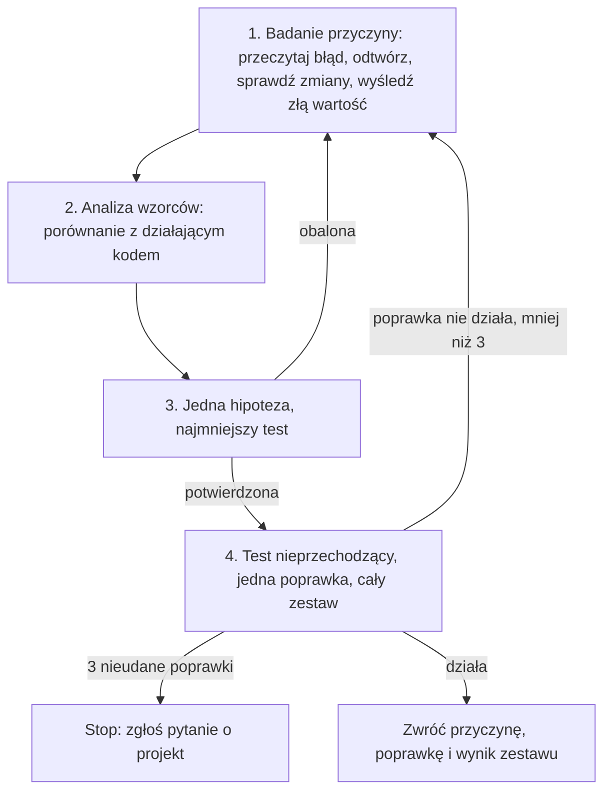

<!-- GENERATED by tools/render.py from templates/skills/debug/README.pl.md + runtimes/claude.json. DO NOT EDIT here; edit the template and re-run tools/render.py. -->
# debug

*[English](README.md) · Polski*

## Co to jest

`debug` to dyscyplina systematycznego debugowania dla każdego błędu, nieprzechodzącego testu, awarii budowania albo nieoczekiwanego zachowania. Wymaga potwierdzonej przyczyny źródłowej przed jakąkolwiek poprawką i działa w czterech fazach: badanie przyczyny źródłowej, analiza wzorców, jedna hipoteza z testem oraz poprawka udowodniona nieprzechodzącym testem.

## Dlaczego

Poprawka zaproponowana przed poznaniem przyczyny jest zgadywaniem, a zgadnięcie, które uciszy objaw, ukrywa defekt. Najpierw badanie jest szybsze niż seria poprawek, których nie da się od siebie odróżnić. Skill ma też regułę zatrzymania: po trzech nieudanych poprawkach problem jest pytaniem o projekt do użytkownika, a nie powodem do czwartej próby.

## Czym nie jest

Nie jest debuggerem i nie dodaje narzędzi ani plików. Nie weryfikuje faktów (to robi `cove`) i nie hartuje strategii (to robi `temper`); oba są krokami opcjonalnymi, do których skill odsyła tam, gdzie pomagają.

## Przebieg

Kroki opcjonalne: `cove` sprawdza twierdzenia faktograficzne, na których stoi diagnoza, a `temper` poddaje próbie poprawkę zmieniającą projekt albo kontrakt. Test z fazy 4 powstaje według skilla `tdd`.

## Jak używać

Wywołaj go jako skill naturalnym zleceniem („zdebuguj ten test”, „znajdź przyczynę”) albo po nazwie: `adhoc-sdlc:debug` w Claude Code, `$debug` w Codexie.

## Źródło

Metoda wywodzi się ze skilla `systematic-debugging` z publicznego zbioru skilli; sformułowania w tym repozytorium są własne.
