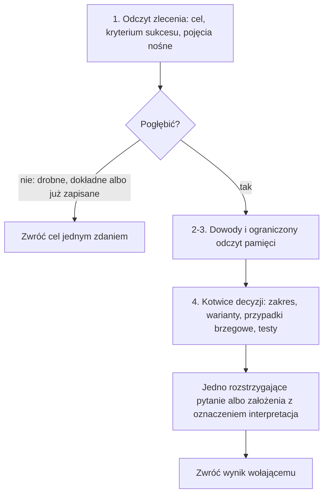

<!-- GENERATED by tools/render.py from templates/skills/intention-hardening/README.pl.md + runtimes/claude.json. DO NOT EDIT here; edit the template and re-run tools/render.py. -->
# intention-hardening

*[English](README.md) · Polski*

## Co to jest

`intention-hardening` to bramka planowania, która utwardza zamiar użytkownika,
zanim powstanie plan. Ustala cel i kryterium sukcesu, nazywa pojęcia nośne
zlecenia z ich znaczeniem w tym projekcie i źródłem tego znaczenia, pokazuje
interpretacje i zadaje tylko to pytanie, które rozstrzyga wynik.

## Dlaczego

CoVe sprawdza fakty, a Temper strategię, ale nic nie sprawdzało, jak odczytano
samo zlecenie. Pojęcie zawężone bez słowa albo zakres poszerzony ponad to, o co
prosił użytkownik, najtaniej wychwycić przed akceptacją planu.

## Czym nie jest

Nie planuje, nie weryfikuje faktów i niczego nie zapisuje. Zwraca wynik
wołającemu, który zapisuje go w istniejących sekcjach (plan adhoc-sdlc albo
kontekst workspace'u FORGE). To nie jest `/forge:harden`, który raportuje
o workspace'ie po jego zakończeniu.

## Proces

1. Odczytaj zlecenie: cel jednym zdaniem, po czym poznamy sukces, każde pojęcie
   nośne ze znaczeniem w projekcie i źródłem; nazwij wprost każde zawężenie albo
   poszerzenie względem słów użytkownika.
2. Obowiązujące decyzje, przebiegi i ostrzeżenia z handoffu traktuj jako dowód;
   trafienie pamięci to tło, dopóki nie potwierdzi go wpis albo źródło.
3. Wykonaj jeden ograniczony odczyt pamięci, potem pytaj zamiast dalej szukać.
   Pamięć i binarka `forge` są opcjonalne: bez nich skill zapisuje „źródła
   niedostępne” i pracuje na źródłach lokalnych.
4. Ustal kotwice decyzji, które mają znaczenie: zakres, warianty z rekomendacją,
   przypadki brzegowe, strategię testów.

Gdy użytkownik mówi „nie pytaj”, zlecenie i tak jest odczytywane, a każda
interpretacja staje się jawnym założeniem. Korekty zamiaru w dialogu są
oznaczane; uogólnialne wracają jako kandydaci do pamięci, skill ich nie zapisuje.

## Miejsce w przepływie

`intention-hardening` działa pierwszy: ustala, czego chcemy, potem `cove`
sprawdza fakty, a `temper` strategię. Woła go `/adhoc-sdlc:plan` oraz `/forge init`
w FORGE: przewodnik init FORGE woła go przed `cove` i `temper`, a bez pluginu
albo gdy brakuje skilla włączonego trybu zatrzymuje się z jawnym komunikatem,
a dalej idzie tylko za zgodą operatora.

## Więcej

Po instrukcje dla agenta, w tym warunki pogłębienia i kształt wyniku, zajrzyj do
`SKILL.md`.

## Autor

Daniel Grabowski <daniel.grabowski@faktoria.io>
