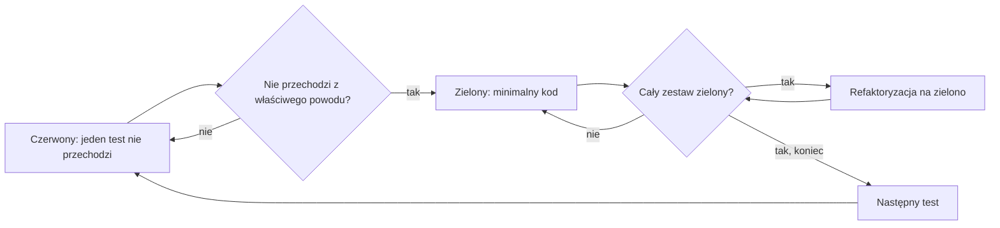

<!-- GENERATED by tools/render.py from templates/skills/tdd/README.pl.md + runtimes/claude.json. DO NOT EDIT here; edit the template and re-run tools/render.py. -->
# tdd

*[English](README.md) · Polski*

## Co to jest

`tdd` to dyscyplina programowania sterowanego testami dla funkcji, poprawek błędów, refaktoryzacji i zmian zachowania. Każdy cykl to czerwony (jeden nieprzechodzący test, obejrzany jako nieprzechodzący z właściwego powodu), zielony (minimalny kod, który przechodzi, przy zielonym całym zestawie) i refaktoryzacja (porządki wyłącznie na zielono).

## Dlaczego

Test napisany po kodzie przechodzi od razu, więc nie dowodzi, że wyłapie defekt, i zwykle opisuje implementację. Test, który widziałeś jako nieprzechodzący, dowodzi, że sprawdza coś realnego, a małe cykle ułatwiają rozumowanie o każdym kroku.

## Czym nie jest

Nie jest frameworkiem testowym i nie dodaje narzędzi: używa komend testowych projektu. Nie weryfikuje faktów (to robi `cove`) i nie hartuje strategii (to robi `temper`); oba są krokami opcjonalnymi, do których skill odsyła tam, gdzie pomagają.

## Przebieg

Kroki opcjonalne: `cove` sprawdza fakt, który zakłada test, a `temper` poddaje próbie strategię testów ryzykownej zmiany. Przy błędzie o nieznanej przyczynie najpierw skill `debug` znajduje przyczynę, a ten skill pisze test regresji.

## Jak używać

Wywołaj go jako skill naturalnym zleceniem („zrób to najpierw testem”, „czerwony, zielony, refaktoryzacja”) albo po nazwie: `adhoc-sdlc:tdd` w Claude Code, `$tdd` w Codexie.

## Źródło

Metoda wywodzi się ze skilla `test-driven-development` z publicznego zbioru skilli; sformułowania w tym repozytorium są własne.
