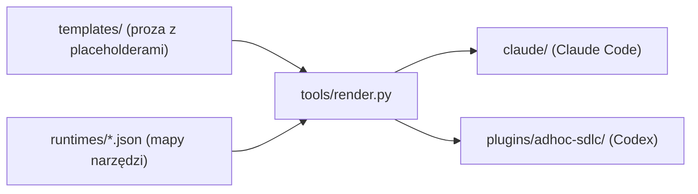

# Struktura repozytorium adhoc-sdlc

Dokument wyjaśnia, jak zorganizowane jest to repozytorium: co gdzie leży, skąd
biorą się pliki dystrybuowane do poszczególnych narzędzi (runtime'ów AI) i jak
jeden zestaw szablonów zamienia się w gotowe warianty. Czytaj go, zanim zaczniesz
edytować prompty skilla albo dodawać nowy runtime.

## 1. Po co to repo

Repozytorium dystrybuuje skill `adhoc-sdlc` (lekki cykl SDLC: plan + wznawialny
dziennik wykonania) oraz skille pomocnicze `intention-hardening` (utwardzanie
zamiaru przed planem), `cove` (weryfikacja faktów), `temper` (hartowanie strategii) i `cleanup-codebase` (ocena porządków w kodzie) do kilku środowisk agentów AI: Claude Code, Codex,
Antigravity (Gemini). Każde środowisko nazywa swoje narzędzia inaczej (np.
pytanie do użytkownika to `AskUserQuestion` w Claude Code, a w Codex opisowo
"a structured question" z natywnym UI wyboru), więc ten sam prompt musi istnieć w
kilku wariantach różniących się nazwami narzędzi i gramatyką. Zamiast utrzymywać
te warianty ręcznie, repo generuje je z jednego źródła.

Zasada przewodnia: jeden neutralny szablon, wiele wariantów per runtime,
generowanych deterministycznie. Cel: zero ręcznie utrzymywanych plików
dystrybucyjnych.

## 2. Mapa katalogów (najwyższy poziom)

```
adhoc-sdlc/
├── templates/          ŹRÓDŁO PRAWDY promptów (proza z placeholderami {{...}})
├── runtimes/           Mapy narzędzi per runtime (claude.json, codex.json, antigravity.json)
├── tools/              Generator i skrypty build-time (render.py, sync-helper.sh, testy)
│
├── claude/             WARIANT WYNIKOWY: plugin Claude Code (generowany przez render.py)
├── plugins/adhoc-sdlc/ WARIANT WYNIKOWY: plugin Codex / marketplace (generowany przez render.py)
├── antigravity/        Instalator dla Antigravity/Gemini (reużywa plugins/)
│
├── .claude-plugin/     Manifest marketplace dla Claude Code (źródło ./claude)
├── .agents/plugins/    Manifest marketplace dla Codex/Antigravity (źródło ./plugins/adhoc-sdlc)
│
├── adhoc-sdlc/         KORPUS roboczy skilla (plany, dzienniki) - gitignored, nie część dystrybucji
├── docs/               Dokumentacja repo (m.in. ten plik)
├── assets/             Grafiki (adhoc-sdlc.png)
│
├── README.md / README.pl.md             Opis projektu (EN + PL)
├── CONTRIBUTING.md / CONTRIBUTING.pl.md  Zasady kontrybucji (EN + PL)
├── PROJECT-JOURNAL.md                    Dziennik decyzji projektu
├── LICENSE, pytest.ini, .gitignore       Meta
```

Uwaga na nazwy: istnieją dwa byty o nazwie `adhoc-sdlc`. Katalog `templates/`,
`claude/`, itd. to repozytorium skilla. Podkatalog `adhoc-sdlc/` w korzeniu to
korpus roboczy (dane), gitignorowany. Nie myl ich.

## 3. Generator: jak szablon staje się wariantem

To główny mechanizm repo. Trzy elementy współpracują:



### 3.1. `templates/` - źródło prawdy

Neutralna proza promptów z tokenami `{{PLACEHOLDER}}` w miejscach, gdzie nazwa
narzędzia albo gramatyka różni się między runtime'ami. Zawartość:

```
templates/
├── commands/                exec.md, handoff.md, history.md, plan.md, resume.md
└── skills/
    ├── adhoc-sdlc/          SKILL.md, reference.md, README.md, README.pl.md
    ├── cove/                SKILL.md, README.md, README.pl.md, agents/openai.yaml (metadane Codex)
    ├── temper/              SKILL.md, README.md, README.pl.md, examples/, integration/
    ├── intention-hardening/ SKILL.md, README.md, README.pl.md
    └── cleanup-codebase/    SKILL.md, README.md, README.pl.md
```

Używane placeholdery (i ile razy występują w szablonach):

| Token                | Znaczenie                                          | Wystąpień |
|----------------------|----------------------------------------------------|-----------|
| `{{ASK}}`            | narzędzie/forma pytania do użytkownika              | 16        |
| `{{ASK_NOTE}}`       | dodatkowa wskazówka do pytania (pusta dla Claude)   | 2         |
| `{{SUBAGENT_VIA}}`   | klauzula "via ..." dla podagenta (pusta dla Codex)  | 4         |
| `{{SKILL_VIA}}`      | klauzula wywołania skilla (`Skill` w Claude, `$<name>` w Codex) | 11 |
| `{{SKILL_HOME}}`     | katalog z SKILL.md/reference.md/scripts             | 26        |
| `{{SKILL_HOME_NOTE}}`| objaśnienie ścieżki skilla (puste dla Claude)       | 1         |
| `{{COMMANDS_HOME}}`  | katalog komend                                      | 2         |
| `{{ASSETS}}`         | prefiks ścieżki do katalogu assets (per runtime)    | 2         |

Placeholdery rozdzielono celowo: `SKILL_HOME` (katalog skilla) i `COMMANDS_HOME`
(katalog komend) to dwie różne kotwice layoutu, bo Claude trzyma komendy w roocie
pluginu, a Codex zagnieżdża je w skillu. `SUBAGENT_VIA`, `ASK_NOTE` i
`SKILL_HOME_NOTE` są puste dla Claude, a niosą treść dla Codex (Codex w prozie
mówi akcjami, nie nazwami narzędzi). `SKILL_VIA` wiąże odwołanie do innego skilla:
w Claude narzędzie `Skill` z nazwą `adhoc-sdlc:<name>` dla skilli pluginu, w Codex
`$<name>` (hipoteza oparta na jedynym dowodzie, `$cove` w `cove/agents/openai.yaml`). `ASSETS` to prefiks ścieżki do katalogu
`assets/`, różny per runtime (Claude trzy poziomy w górę, Codex cztery), bo README
skilli leżą na różnej głębokości względem korzenia repo.

Lista zadań wykonania nie ma placeholdera (od wydania 0.6.0): plan definiuje zadania
w sekcji `## Tasks` (punkty `- [T1] <tytuł>`), a ich stan prowadzi helper w dzienniku
`execute-*.json` (`schema: 2`, flagi `--task`, `--task-status`, `--task-add`, komenda
`tasks`), tak samo w Claude Code i Codex. Szablony nie odwołują się do natywnego
narzędzia listy zadań żadnego runtime'u.

Szablony edytujesz ręcznie. To jedyne miejsce, gdzie zmieniasz treść promptów.

### 3.2. `runtimes/<rt>.json` - mapy narzędzi per runtime

Każdy runtime ma jeden plik JSON z polami:

- `runtime` - nazwa (claude / codex / antigravity),
- `active` - czy generator ma go renderować,
- `placeholders` - mapowanie każdego tokenu na konkretny tekst,
- `files` - lista par `[ścieżka_szablonu, ścieżka_wyjściowa]`.

Przykład (`runtimes/claude.json`): `{{ASK}}` -> `` `AskUserQuestion` ``,
`{{SKILL_HOME}}` ->
`${CLAUDE_PLUGIN_ROOT}/skills/adhoc-sdlc`. `files` kieruje render do `claude/...`.
W `runtimes/codex.json` te same tokeny mapują się na frazy opisowe
(`a structured question`),
`{{SKILL_HOME}}` -> `<skill-dir>`, a `files` kieruje render do
`plugins/adhoc-sdlc/...`.

Stan flag `active` (czerwiec 2026):

| Runtime      | active | Placeholdery                  | Cel `files`              |
|--------------|--------|-------------------------------|--------------------------|
| claude       | true   | nazwy narzędzi Claude Code    | `claude/...`             |
| codex        | true   | frazy opisowe (mów akcjami)   | `plugins/adhoc-sdlc/...` |
| antigravity  | false  | szkielet, same `TODO-confirm` | brak (`files: []`)       |

Czyli generator produkuje oba realne warianty: Claude Code (`claude/`) i plugin
Codex (`plugins/adhoc-sdlc/`). Antigravity to nadal szkielet (placeholdery typu
`TODO-confirm-...` nie wolno zgadywać; trzeba potwierdzić realne narzędzia przed
`active=true`); render go pomija.

### 3.3. `tools/render.py` - renderowanie

Dla każdego aktywnego runtime (lub jednego wskazanego przez `--runtime`):

1. wczytuje szablon, podstawia placeholdery z mapy runtime,
2. wstawia nagłówek `GENERATED by tools/render.py ... DO NOT EDIT here`, w stylu
   zależnym od rozszerzenia wyjścia: dla `.md` komentarz HTML
   `<!-- ... -->` (po bloku frontmatter, żeby się parsował), dla `.yaml`/`.yml`
   komentarz `# ...` (inaczej HTML zepsułby YAML),
3. zapisuje do ścieżki wyjściowej z `files`,
4. twardo przerywa, jeśli w szablonie jest token bez mapowania albo po renderze
   zostaje nieoczekiwany placeholder.

Tryby:

```
python3 tools/render.py                 # renderuj wszystkie aktywne runtime'y
python3 tools/render.py --runtime codex # renderuj jeden (ignoruje active)
python3 tools/render.py --check         # tylko sprawdź zgodność, niezerowy kod przy dryfcie
```

`--check` to bramka driftu: uruchom ją po zmianie szablonu albo mapy, żeby
potwierdzić, że pliki na dysku odpowiadają źródłu. Testy generatora są w
`tools/test_render.py`.

### 3.4. Skąd wiadomo, że plik jest generowany

Każdy wygenerowany plik ma w nagłówku komentarz `GENERATED by tools/render.py
from templates/... + runtimes/<rt>.json. DO NOT EDIT here`. Jeśli pliku nie ruszał
generator (np. wariant `antigravity/`, bo jego runtime jest `active=false`), tego
nagłówka nie ma - taki plik jest utrzymywany ręcznie do czasu włączenia runtime.

## 4. Warianty wynikowe (gdzie jest efekt dla danego narzędzia)

### 4.1. `claude/` - plugin Claude Code (generowany)

```
claude/
├── .claude-plugin/plugin.json     manifest pluginu Claude Code
├── commands/                      plan.md, exec.md, resume.md, history.md, handoff.md (generowane)
└── skills/
    ├── adhoc-sdlc/                SKILL.md, reference.md, README.md, README.pl.md (generowane); scripts/
    ├── cove/                      SKILL.md, README.md, README.pl.md (generowane)
    ├── temper/                    SKILL.md, README.md, README.pl.md, examples/, integration/ (generowane)
    ├── intention-hardening/       SKILL.md, README.md, README.pl.md (generowane)
    └── cleanup-codebase/          SKILL.md, README.md, README.pl.md (generowane)
```

Komendy leżą w roocie pluginu (`commands/`), bo Claude Code tak je odkrywa.
Katalog `scripts/` zawiera kanoniczną kopię helpera Python (patrz sekcja 5);
`README*.md` skilla są teraz generowane z `templates/` (placeholder `{{ASSETS}}`
daje poprawną ścieżkę do `assets/`).

### 4.2. `plugins/adhoc-sdlc/` - plugin Codex / marketplace (generowany)

```
plugins/adhoc-sdlc/
├── .codex-plugin/plugin.json   manifest pluginu (wersja 0.7.0)
└── skills/
    ├── adhoc-sdlc/             SKILL.md, reference.md, README.md, README.pl.md, commands/, scripts/ (generowane + helper)
    ├── cove/                   SKILL.md, README.md, README.pl.md, agents/openai.yaml (generowane)
    ├── temper/                 SKILL.md, README.md, README.pl.md, examples/, integration/ (generowane)
    ├── intention-hardening/    SKILL.md, README.md, README.pl.md (generowane)
    └── cleanup-codebase/       SKILL.md, README.md, README.pl.md (generowane)
```

Komendy są zagnieżdżone w skillu (`skills/adhoc-sdlc/commands/`), inaczej niż w
Claude - to layout, którego Codex oczekuje. `render.py` pisze tu wszystkie `.md`
i `agents/openai.yaml`; helper `.py` trafia tu przez `sync-helper.sh`. To pakiet
instalowany jako plugin Codex z marketplace (patrz sekcja 6) oraz baza skilli dla
Antigravity.

### 4.3. `antigravity/` - instalator dla Antigravity/Gemini

```
antigravity/
├── README.md     roadmap i kontekst
└── install.sh    rejestruje plugins/adhoc-sdlc/skills w ~/.gemini/config/skills.json
```

Antigravity nie ma własnego drzewa skilli. `install.sh` dopisuje ścieżkę
`plugins/adhoc-sdlc/skills` do konfiguracji Gemini, więc Antigravity reużywa
wariantu `plugins/`.

## 5. Helper Python i jego synchronizacja

Logika tworzenia plików planu i dziennika to kod Python, nie sam prompt:

- `adhoc_sdlc.py` - główny helper (tryby `plan`, `execute`, `pack`, `config`),
- `sdlc_doc.py` - operacje na sekcjach dokumentu,
- `test_append.py`, `test_config.py`, `test_execute_json.py`, `test_pack.py`,
  `test_sdlc_doc.py` - testy.

Kanoniczna kopia żyje w `claude/skills/adhoc-sdlc/scripts/`. Pakiety pluginów nie
mogą sięgać po pliki spoza własnego drzewa, więc helper jest fizycznie
duplikowany. `tools/sync-helper.sh` kopiuje wszystkie pliki `.py` z kopii
kanonicznej do `plugins/adhoc-sdlc/skills/adhoc-sdlc/scripts`. Uruchom go po
każdej zmianie helpera, potem `pytest` w każdym katalogu `scripts/`.

Podział odpowiedzialności: `render.py` synchronizuje prompty (`.md`/`.yaml` z
`templates/`), `sync-helper.sh` synchronizuje kod (`.py` z `claude/`). To dwa
różne mechanizmy dla dwóch różnych rodzajów treści.

## 6. Manifesty marketplace

| Plik                              | Dla kogo                | Źródło pluginu        |
|-----------------------------------|-------------------------|------------------------|
| `.claude-plugin/marketplace.json` | Claude Code             | `./claude`             |
| `.agents/plugins/marketplace.json`| Codex / Antigravity     | `./plugins/adhoc-sdlc` |

`.claude-plugin/marketplace.json` niesie też wersję pakietu (`0.7.0`). To pliki,
które środowisko czyta, żeby wiedzieć, skąd zainstalować plugin. Instalacja i
aktualizacja idą z GitHuba (`codex plugin marketplace add daniel-grabowski/adhoc-sdlc`,
`/plugin marketplace add ...`), nie z lokalnego checkoutu.

## 7. Korpus roboczy `adhoc-sdlc/`

Podkatalog `adhoc-sdlc/` w korzeniu repo to dane produkowane przez sam skill
podczas pracy: `plan-*.md`, `execute-*.json`, `handoff-*.md`. Jest gitignorowany
(`/adhoc-sdlc/` w `.gitignore`) - to katalog roboczy, nie część dystrybucji. Tu
trafiają plany i dzienniki konkretnych zadań prowadzonych przez skill.

## 8. Typowe przepływy pracy

- Zmiana treści promptu skilla: edytuj plik w `templates/`, uruchom
  `python3 tools/render.py`, potwierdź `--check`. Nigdy nie edytuj wygenerowanych
  plików w `claude/` ani `plugins/` ręcznie (nagłówek GENERATED ostrzega).
- Zmiana logiki helpera: edytuj `claude/skills/adhoc-sdlc/scripts/*.py`, uruchom
  `tools/sync-helper.sh`, potem `pytest` w każdym `scripts/` oraz `pytest tools`.
- Nowa nazwa narzędzia/forma dla istniejącego runtime: zmień `placeholders` w
  `runtimes/<rt>.json`, przerenderuj.
- Włączenie nowego runtime (antigravity): uzupełnij realne narzędzia w jego
  `runtimes/<rt>.json` (zastąp `TODO-confirm-...`), ustaw `active=true`, uzupełnij
  `files`, przerenderuj.

## 9. Stan obecny i dług

- Generator produkuje oba realne warianty: `claude/` i `plugins/adhoc-sdlc/`
  (oba `active=true`), wraz ze skillami `intention-hardening`, `cove`, `temper` i `cleanup-codebase`, ich README (EN+PL) oraz
  metadanymi Codex `cove/agents/openai.yaml`. Brak już ręcznie utrzymywanej prozy
  dystrybucyjnej i brak legacy wariantu `codex/`.
- `antigravity.json` to wciąż szkielet (`active=false`) z placeholderami do
  potwierdzenia; Antigravity reużywa `plugins/`, ale własnego renderu nie ma do
  czasu potwierdzenia jego narzędzi.
- Ręcznie utrzymywane pozostają tylko: kanoniczna kopia helpera `.py` (synchro
  przez `sync-helper.sh`), dokumentacja repo-level (główne `README*.md`,
  `CONTRIBUTING*.md`, ten plik, `antigravity/README.md`), manifesty i meta repo.
