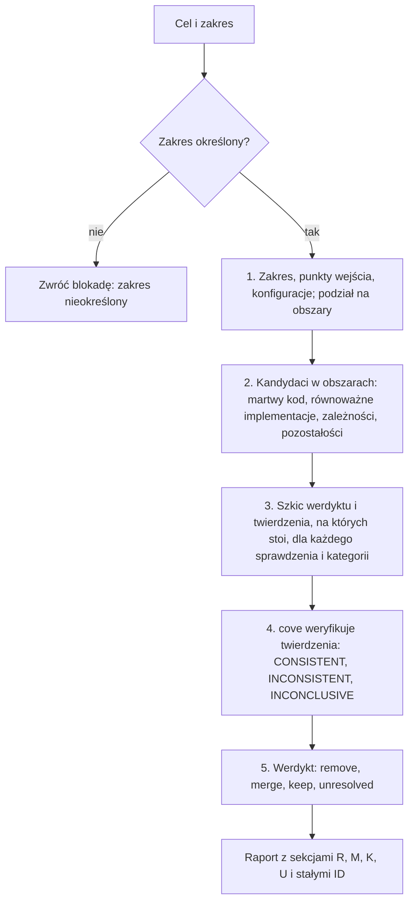
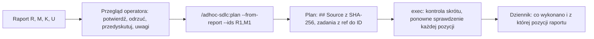

<!-- GENERATED by tools/render.py from templates/skills/cleanup-codebase/README.pl.md + runtimes/codex.json. DO NOT EDIT here; edit the template and re-run tools/render.py. -->
# cleanup-codebase

*[English](README.md) · Polski*

## Co to jest

`cleanup-codebase` to oparta na dowodach ocena porządków w kodzie. Dla podanego
celu i zakresu dzieli zakres na obszary, wyszukuje martwy kod, równoważne
implementacje, zbędne zależności i pozostałości zmian, zleca weryfikację
twierdzeń stojących za każdym werdyktem skillowi `cove` i dostarcza raport
z jednym werdyktem i stałym identyfikatorem dla każdego kandydata: `remove` (R1,
R2, ...), `merge` (M1, ...), `keep` (K1, ...) albo `unresolved` (U1, ...).

## Dlaczego

Pozostałości i powielony kod podnoszą koszt każdej kolejnej zmiany i obciążają
kontekst agenta, ale usuwanie ich na podstawie pustego wyszukiwania jest ryzykowne:
do kodu można dojść po nazwie z danych, konfiguracji, rejestracji, kodu
generowanego albo z innych repozytoriów.

**Sprzątanie kodu bez analizy faktograficznej jest wielokrotnie droższe niż
weryfikacja.** Usunięcie czegoś, co działało przez niewidoczny punkt wejścia,
kosztuje awarię, diagnozę i przywracanie; weryfikacja kosztuje tylko czas agenta.
Dlatego każdy werdykt `remove` i `merge` stoi na twierdzeniach sprawdzonych przez
`cove`, dla każdego kandydata, bez próbkowania. Koszt tej weryfikacji jest
świadomie akceptowany.

## Czym nie jest

Nie zmienia kodu ani konfiguracji projektu, nie wykonuje git, nie buduje i nie
uruchamia testów. Jedynym skutkiem jest raport. Zmiany wprowadza `exec`
w adhoc-sdlc albo builder w przebiegu FORGE, według własnych zasad weryfikacji.
Jest niezależny od stosu: sposób sprawdzenia kategorii w danym stosie wynika
z reguł i skilli projektu.

## Proces

1. Ustal zakres, jego punkty wejścia i wspierane konfiguracje; większy zakres
   podziel na obszary.
2. Wyszukaj kandydatów w czterech grupach; równoważne implementacje tworzą
   jednego kandydata na grupę scalenia.
3. Zapisz szkic werdyktu i jego twierdzenia: wyszukiwanie, osiągalność, testy,
   konfiguracja oraz każda kategoria niejawnych punktów wejścia (dynamiczne
   wywołania i refleksja, rejestracje, odwołania po nazwie w danych, zasobach
   i konfiguracji, kod generowany, publiczne API).
4. Uruchom `cove` na twierdzeniach każdego kandydata. `cove` sam układa otwarte
   pytania i odpowiada na nie ze źródeł, niezależnie od szkicu. Gdy `cove` jest
   niedostępny, ocena zatrzymuje się; za zgodą operatora może iść dalej, ale
   wtedy daje tylko `keep` albo `unresolved`, nigdy `remove` ani `merge`.
5. Przełóż wynik na werdykt: wszystkie twierdzenia CONSISTENT utrzymują `remove`
   albo `merge`, twierdzenie INCONSISTENT daje `keep`, twierdzenie INCONCLUSIVE
   albo niesprawdzalna kategoria daje `unresolved`, nigdy `remove`.

## Raport

Raport podaje datę, cel, zakres, ograniczenia i legendę prefiksów, a potem cztery
sekcje w stałej kolejności: Remove (R), Merge (M), Keep (K), Unresolved (U).
Prefiksy pochodzą od angielskich werdyktów i nie zmieniają się z językiem raportu,
więc „wykonaj R1 i M1” zawsze wskazuje te same dwie pozycje. Numeracja zaczyna się
od 1 w każdej sekcji; pusta sekcja mówi „Brak kandydatów”. Identyfikator nigdy się
nie zmienia: późniejsza zmiana werdyktu jest zapisywana jako decyzja z tym ID.
Każda pozycja ma lokalizację, werdykt, pytania i odpowiedzi `cove` ze źródłem,
ryzyko i zasięg. Dowody wskazują źródła i nigdy nie cytują wartości konfiguracji
ani sekretów.

Forma dostarczenia zależy od środowiska:

- **Claude Code:** domyślnie interaktywny artefakt, który jest jednocześnie
  raportem i formularzem przeglądu. Każda pozycja ma opis, wyjaśnienie dowodów
  i rekomendacji, przyciski opcji z zaznaczoną rekomendacją i pole uwag; zmiany
  zapisują się automatycznie, a agent odczytuje decyzje i uwagi każdego ID z danych
  artefaktu. Plik Markdown tylko na życzenie albo przy niedostępnym narzędziu
  artefaktu.
- **Codex:** plik Markdown (domyślnie `research/cleanup-<zakres>-<znacznik czasu>.md`,
  bez nadpisywania wcześniejszego raportu, nieśledzony), z odnośnikiem
  w odpowiedzi.

## Od raportu do wykonania

Raport jest propozycją, nie werdyktem ostatecznym. Przegląd operatora jest
obowiązkowy: jego wiedza jest dowodem i może odwrócić werdykt (np. „R1 -> keep:
używa tego klient X”), a każda taka decyzja jest zapisywana z ID i źródłem
`operator`. Do planu wchodzą tylko werdykty `remove` i `merge` po przeglądzie.
`exec` zatrzymuje się, gdy raport zmienił się po planowaniu (przy „nie pytaj”
zapisuje odstępstwo i opiera się na ponownym sprawdzeniu każdej pozycji), sprawdza
każdą pozycję ponownie na bieżącym kodzie („already done” albo „unresolved” zamiast
zmiany na ślepo), a dziennik zapisuje odwołanie każdego zadania do pozycji
raportu.

## Miejsce w przepływie

Działa na żądanie, jako wejście `/adhoc-sdlc:plan --from-report`, przez
opcjonalny tryb `cleanup-codebase` w `/adhoc-sdlc:plan` (rejestr trafia do planu,
a na końcu `exec` do dziennika) albo w FORGE, gdzie rejestr trafia do wołającego
i staje się zakresem zadania. `temper` może sprawdzić strategię porządków; ani
`cove`, ani `temper` nie zastępuje analizy kodu.

## Więcej

Po instrukcje dla agenta, w tym reguły werdyktów, format raportu i formę
dostarczenia, zajrzyj do `SKILL.md`.

## Autor

Daniel Grabowski <daniel.grabowski@faktoria.io>
