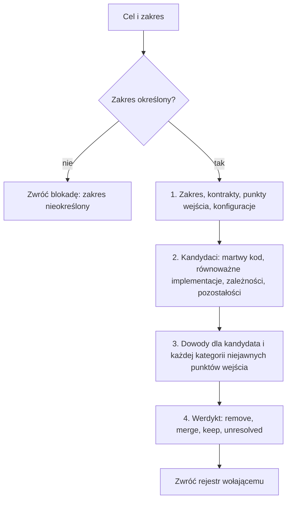

<!-- GENERATED by tools/render.py from templates/skills/cleanup-codebase/README.pl.md + runtimes/codex.json. DO NOT EDIT here; edit the template and re-run tools/render.py. -->
# cleanup-codebase

*[English](README.md) · Polski*

## Co to jest

`cleanup-codebase` to oparta na dowodach ocena porządków w kodzie. Dla podanego
celu i zakresu wyszukuje martwy kod, równoważne implementacje, zbędne zależności
i pozostałości zmian, sprawdza każdego kandydata pod kątem kategorii niejawnych
punktów wejścia i zwraca rejestr kandydatów z jednym werdyktem dla każdego:
`remove`, `merge`, `keep` albo `unresolved`.

## Dlaczego

Pozostałości i powielony kod podnoszą koszt każdej kolejnej zmiany i obciążają
kontekst agenta, ale usuwanie ich na podstawie pustego wyszukiwania jest ryzykowne:
do kodu można dojść po nazwie z danych, konfiguracji, rejestracji, kodu
generowanego albo z innych repozytoriów. Skill czyni tę decyzję powtarzalną
i opartą na dowodach, więc proces, który edytuje pliki, usuwa tylko to, co
dowody uzasadniają.

## Czym nie jest

Nie edytuje plików, nie wykonuje git, nie buduje i nie uruchamia testów. Zwraca
rejestr wołającemu: zmiany wprowadza `exec` w adhoc-sdlc albo builder
w przebiegu FORGE, według własnych zasad weryfikacji. Jest niezależny od stosu:
sposób sprawdzenia kategorii w danym stosie wynika z reguł i skilli projektu.

## Proces

1. Ustal zakres, jego kontrakty, punkty wejścia i wspierane konfiguracje.
2. Wyszukaj kandydatów w czterech grupach.
3. Zbierz dowody dla każdego kandydata: wyszukiwanie, osiągalność, testy,
   konfiguracja oraz każda kategoria niejawnych punktów wejścia (dynamiczne
   wywołania i refleksja, rejestracje, odwołania po nazwie w danych, zasobach
   i konfiguracji, kod generowany, publiczne API). Brak trafień i zielone testy
   nigdy nie są samodzielnym dowodem.
4. Nadaj każdemu kandydatowi jeden werdykt. Kategoria, której nie da się
   sprawdzić, daje `unresolved`, nigdy `remove`.

## Rejestr

Jeden wiersz na kandydata: lokalizacja, werdykt, dowody z podziałem na kategorie,
ryzyko i zasięg (pliki i zależności), pod datą oceny, celem i zakresem.
Znaleziska spoza zakresu trafiają na listę propozycji. Mniejszy rozmiar
instalacji podaje się tylko po pomiarze.

## Miejsce w przepływie

Działa na żądanie, przez opcjonalny tryb `cleanup-codebase` w `/adhoc-sdlc:plan`
(rejestr zasila plan i `exec`) albo w FORGE, gdzie rejestr staje się zakresem
zadania. `cove` może sprawdzić twierdzenia, na których stoi werdykt, a `temper`
strategię porządków; żaden z nich nie zastępuje analizy kodu.

## Więcej

Po instrukcje dla agenta, w tym reguły werdyktów i format rejestru, zajrzyj do
`SKILL.md`.

## Autor

Daniel Grabowski <daniel.grabowski@faktoria.io>
