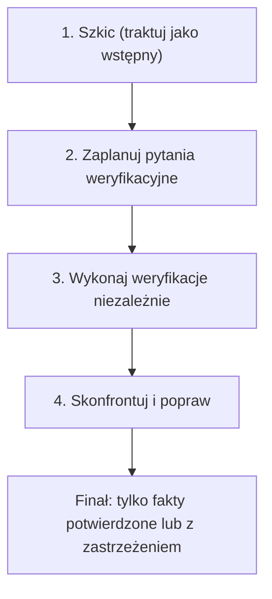

<!-- GENERATED by tools/render.py from templates/skills/cove/README.pl.md + runtimes/codex.json. DO NOT EDIT here; edit the template and re-run tools/render.py. -->
# CoVe

*[English](README.md) · Polski*

## Co to jest

`cove` to Chain-of-Verification dla twierdzeń faktograficznych: napisz szkic
odpowiedzi, zadaj niezależne pytania weryfikacyjne, odpowiedz na nie bez opierania
się na szkicu i popraw finalną odpowiedź tak, by została w niej tylko treść, która
przeszła weryfikację.

## Dlaczego

Sięgaj po niego, gdy poprawność jest ważniejsza od szybkości. Ogranicza
zmyślone i nadmiernie pewne twierdzenia, bo wymusza, by finalna odpowiedź
zawierała tylko fakty potwierdzone albo jawnie oznaczone jako niepewne. Pasuje do
odpowiedzi, list, streszczeń, audytów, cytowań i każdego tekstu dla użytkownika,
gdzie błędny fakt dużo kosztuje.

## Proces

1. Napisz bazową odpowiedź i traktuj ją jako wstępną, nie jako prawdę.
2. Sformułuj jedno otwarte pytanie na twierdzenie, każde odpowiadalne niezależnie.
3. Odpowiedz na każde pytanie ze źródła prawdy, nie pozwalając, by szkic narzucił
   odpowiedź; użyj narzędzi zewnętrznych (web, repo, testy, dokumentacja, baza),
   gdy fakt jest świeży, wysokiej stawki albo zależny od źródła.
4. Oznacz każde twierdzenie jako `CONSISTENT`, `INCONSISTENT` albo `INCONCLUSIVE`,
   potem napisz finalną odpowiedź wyłącznie z twierdzeń potwierdzonych albo jawnie
   opatrzonych zastrzeżeniem.

## Kiedy używać

Sięgaj po niego przy listach („wymień kilka X, które Y"), biografiach oraz
twierdzeniach historycznych i technicznych (osie czasu, wersje, ścieżki plików,
komendy, dokładna treść błędu). Przy generowaniu kodu i poprawkach błędów opieraj
się na testach i sprawdzeniach w czasie wykonania; CoVe stosuj tylko do twierdzeń
faktograficznych wokół kodu.

Wybieraj mniej faktów potwierdzonych zamiast wielu niepewnych i unikaj pytań
weryfikacyjnych tak/nie, bo sprzyjają potakiwaniu.

## Granica dowodowa

Nie wyolbrzymiaj wyników artykułu źródłowego. Często cytowana liczba
`~17% -> ~70%` dotyczy konkretnego zadania listowego na Wikidata (Llama 65B), a nie
uniwersalnej gwarancji dokładności; traktuj ją jako dowód, że krótka, celna
weryfikacja ujawnia fakty pominięte w długiej generacji. Źródło: Dhuliawala i in.,
„Chain-of-Verification Reduces Hallucination in Large Language Models",
Findings of ACL 2024 (arXiv 2023). Artykuł nie obejmuje użycia narzędzi
zewnętrznych, więc łącz CoVe z właściwym dla zadania źródłem prawdy.

## Więcej

Po instrukcje dla agenta, w tym pełny kształt wyjścia i wzorce per typ zadania,
zajrzyj do `SKILL.md`.

## Autor

Daniel Grabowski <daniel.grabowski@faktoria.io>
