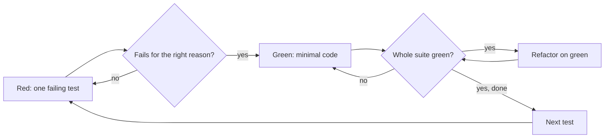

<!-- GENERATED by tools/render.py from templates/skills/tdd/README.md + runtimes/codex.json. DO NOT EDIT here; edit the template and re-run tools/render.py. -->
# tdd

*English · [Polski](README.pl.md)*

## What

`tdd` is a test-driven development discipline for features, bug fixes, refactoring, and behavior changes. Each cycle is red (one failing test, watched failing for the right reason), green (the minimal code that passes, with the whole suite green), and refactor (cleanup on green only).

## Why

A test written after the code passes at once, so it proves nothing about catching a defect and tends to describe the implementation. A test you saw fail proves it checks something real, and the small cycles keep each step easy to reason about.

## What it is not

It is not a test framework and adds no tooling: it uses the project's own test commands. It does not verify facts (that is `cove`) and does not harden a strategy (that is `temper`); both are optional steps it points to where they help.

## Process

Optional steps: `cove` checks a fact a test assumes, and `temper` pressure-tests the test strategy of a risky change. For a bug with an unknown cause, the `debug` skill finds the cause first and this skill writes the regression test.

## How to use

Invoke it as a skill with a natural request ("do this test first", "red-green-refactor"), or by name: `adhoc-sdlc:tdd` in Claude Code, `$tdd` in Codex.

## Source

The method is adapted from the `test-driven-development` skill of the Superpowers plugin; the wording here is the repository's own.
