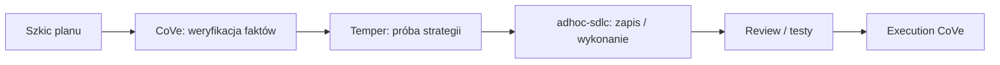

<!-- GENERATED by tools/render.py from templates/skills/temper/README.pl.md + runtimes/codex.json. DO NOT EDIT here; edit the template and re-run tools/render.py. -->
# temper

*[English](README.md) · Polski*

## Co to jest

`temper` to bramka hartowania strategii w Harness. Poddaje plan, architekturę
albo kierunek implementacji próbie pod kątem konkretnych trybów awarii, zanim
strategia zamieni się w kod.

## Dlaczego

Sięgaj po niego, gdy plan wygląda sensownie, ale koszt pomyłki jest wysoki. Cel
nie polega na rozbudowie planu, tylko na tym, żeby plan był odporny. Każde istotne
ryzyko kończy się na jeden z trzech sposobów: plan zmienia się, by je zamknąć,
ryzyko zostaje świadomie zaakceptowane z podanym powodem, albo obawa zostaje
odrzucona jako spekulacja (lub odesłana do CoVe, gdy zależy od niezweryfikowanego faktu).

## Czym nie jest

`temper` nie weryfikuje faktów, nie recenzuje kodu linijka po linijce i nie
rozszerza funkcji poza cel planu. To jedno z kilku narzędzi:

- CoVe sprawdza, czy twierdzenie jest prawdziwe.
- Temper sprawdza, czy strategia wytrzyma realistyczne tryby awarii.
- Review i testy sprawdzają implementację.
- `adhoc-sdlc` utrwala plan, dziennik, ścieżkę wznawiania i historię.

## Miejsce w Harness

`temper` działa po weryfikacji faktów, a przed wykonaniem.



## Jak używać

Komenda `/temper` nie istnieje. Wywołujesz go na dwa sposoby:

- jako skill, naturalnym zleceniem w stylu „zahartuj ten plan przed wykonaniem",
  „przetestuj tę strategię pod kątem awarii" albo „znajdź tu tryby awarii";
- przez bramkę jakości `strategy-temper` w `/adhoc-sdlc:plan`, która uruchamia ten
  sam przebieg trybów awarii po Plan CoVe, a przed zapisem planu.

Uruchomiony w `/adhoc-sdlc:plan`, wynik trafia do treści planu jako sekcje
`## Tempered Risks` i `## Accepted Risks`, z poprawkami już wpiętymi w plan, a nie
zostawionymi jako osobna lista zadań. Poprawka mieści się w celu planu; zmiana,
która dodałaby zachowanie albo zakres spoza celu, trafia do sekcji
`Operator options` (z uzasadnieniem i kosztem) do decyzji operatora; opcję
przyjętą zapisuje się jako `Widening: <change>`, a odrzuconą (albo każdą przy
„nie pytaj”) w `## Accepted Risks`.

## Integracja z adhoc-sdlc

Zobacz [integration/adhoc-sdlc-integration.md](integration/adhoc-sdlc-integration.md):
bramka Faza 0, klucz `## Mode`, kolejność w planowaniu i odblokowane kąty historii.
Pełny przebieg jest w [examples/sample-output.md](examples/sample-output.md).

## Instalacja

`temper` jest częścią pluginu `adhoc-sdlc` dla Claude Code i Codex, więc instalacja
tego pluginu instaluje także ten skill. Do użycia samodzielnego skopiuj katalog
`temper/` do katalogu skilli swojego środowiska; minimalna struktura to:

```text
temper/
  SKILL.md
  README.md
  integration/
    adhoc-sdlc-integration.md
  examples/
    sample-output.md
```

## Autor

Daniel Grabowski <daniel.grabowski@faktoria.io>
