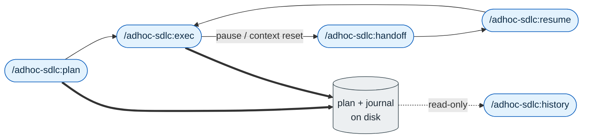

<p align="center">
  
</p>

# adhoc-sdlc

*English · [Polski](README.pl.md)*

## What

`adhoc-sdlc` is a lightweight SDLC for small implementation work in the current project: too small for a formal issue, but important enough to deserve a real plan and a resumable execution history.

## Why

Ad hoc coding work often fails because the context disappears: what was planned, what changed, what was verified, and what remains. This skill keeps that trail on disk so an agent can continue safely after a pause, handoff, or context reset. That on-disk record also makes the work checkable afterward, which is the difference between engineering and hoping the change went fine.

## What it does

The skill turns a quick request into two tracked artifacts under `./adhoc-sdlc`:

- a confirmed plan (`plan-*.md`),
- an incremental execution journal (`execute-*.json`) that records what you changed, what you verified, and what is left.

A Python helper owns both files, so the record stays consistent and you can resume a session later from disk alone.

## When to use

Reach for it when the task is real implementation work but does not justify a formal issue:

- ad hoc fixes,
- quick features,
- refactors you want planned and logged.

Skip it when the work already belongs to a formal issue workflow that has its own source of truth, or when the exchange is just a question with no implementation.

## Commands

| Command | Role |
|---------|------|
| `/adhoc-sdlc:plan` | settle the design decisions and save a confirmed plan |
| `/adhoc-sdlc:exec` | run the plan and keep the execution journal |
| `/adhoc-sdlc:handoff` | snapshot session state before a context switch |
| `/adhoc-sdlc:resume` | reload one of the recent sessions and continue |
| `/adhoc-sdlc:history` | analyze past sessions for a given angle (read-only) |

## How a session flows



Rounded nodes are commands and the cylinder is the on-disk record; thick edges write to it, the dotted edge only reads it, and `handoff` and `resume` bridge the context-window boundary.

1. `plan` runs as a guided conversation. It first asks how to work (the Phase 0 mode gate: brainstorming dialog, deep code verification, test execution, plan CoVe, strategy temper, and execution CoVe), then settles scope, approach, edge cases, and a test plan, and writes the plan file.
2. `exec` seeds a native todo list from the plan, works through it, and appends a journal entry for each significant step. It always ends with a final self-check recorded in the journal.
3. `handoff` and `resume` carry state across context windows: one snapshots, the other reloads and picks up from the next steps.
4. `history` reads the whole corpus through the helper to answer a question about past work.

## Related skills

The plugin also ships two gates this workflow can call: [`cove`](../cove/README.md) for Chain-of-Verification of factual claims, and [`temper`](../temper/README.md) for hardening a plan's strategy against failure modes. Both are available on their own and as quality gates inside `/adhoc-sdlc:plan` (plan CoVe, strategy temper, execution CoVe).

## Files

```
adhoc-sdlc/
  SKILL.md       agent-facing instructions (the source of truth)
  reference.md   file contract: frontmatter, helper flags, journal operations
  README.md      this overview (English)
  README.pl.md   this overview (Polish)
  scripts/       the Python helper (adhoc_sdlc.py) and its tests
```

Plans and journals are written to `./adhoc-sdlc/` inside the current project, not here.

## The helper

`scripts/adhoc_sdlc.py` is the only writer of the `adhoc-sdlc/` files. Journal entries change only through its flags (`--append`, `--decision`, `--verification`, `--final`), never by editing the JSON by hand. For `history`, `resume`, and `handoff`, the same helper (`pack` mode) is the only reader: it discovers, parses, and budgets the context, and the agent works from the pack it returns instead of scanning the files directly.

## Language

The instructions in this skill are written in English, which is the source of truth. The behavior adapts to the conversation: user-facing output matches the user's language, while machine-facing identifiers (semantic names, filenames) stay ASCII kebab-case.

## More detail

See `SKILL.md` for the agent-facing instructions and `reference.md` for the full file contract. The command definitions live in the plugin's `commands/` directory.

## Author

Daniel Grabowski <daniel.grabowski@faktoria.io>
