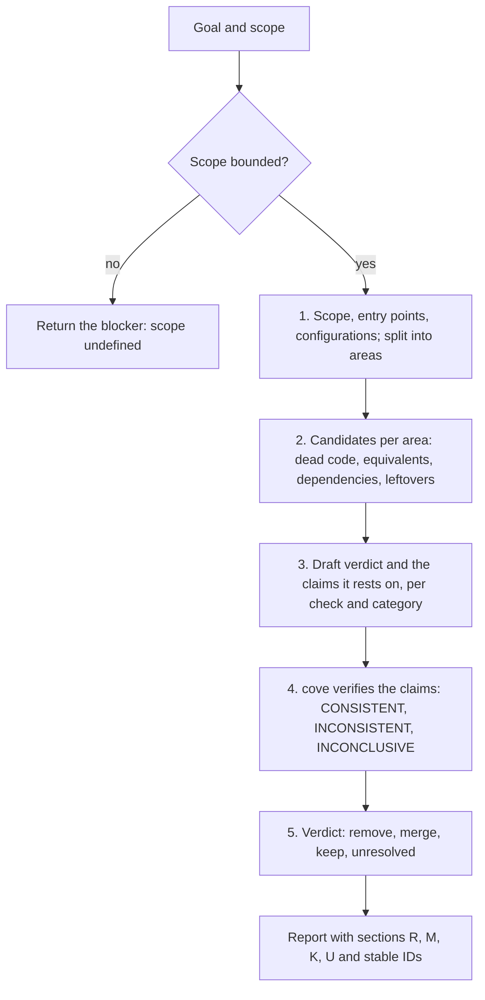
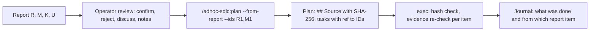

# cleanup-codebase

*English · [Polski](README.pl.md)*

## What

`cleanup-codebase` is an evidence-based cleanup assessment. Given a goal and a
scope, it splits the scope into areas, finds dead code, equivalent
implementations, unneeded dependencies, and leftovers of changes, has the claims
behind every verdict verified by the `cove` skill, and delivers a report with one
verdict and a stable ID per candidate: `remove` (R1, R2, ...), `merge` (M1, ...),
`keep` (K1, ...), or `unresolved` (U1, ...).

## Why

Leftover and duplicated code raises the cost of every later change and loads the
agent's context, but removing it on the strength of an empty search is risky: code
can be reached by name from data, configuration, registrations, generated code, or
other repositories.

**Cleaning up without fact verification costs far more than verifying first.**
Removing something that worked through an invisible entry point costs an outage,
a diagnosis, and a restore; verification costs only agent time. That is why every
`remove` and `merge` verdict rests on claims checked by `cove`, for every
candidate, without sampling. The cost of that check is accepted on purpose.

## What it is not

It does not change the project's code or configuration, run git, build, or run
tests. Its only effect is the report. `exec` in adhoc-sdlc or the builder in a
FORGE run applies the changes under its own verification rules. It is
stack-agnostic: how to check a category in a given stack comes from the project's
rules and skills.

## Process

1. Establish the scope, its entry points, and supported configurations; split a
   larger scope into areas.
2. Find candidates in the four groups; equivalent implementations form one
   candidate per merge group.
3. Write a draft verdict and its claims: search, reachability, tests,
   configuration, and every category of implicit entry points (dynamic calls and
   reflection, registrations, references by name in data, resources, and
   configuration, generated code, public API).
4. Run `cove` on the claims of every candidate. It asks its own open questions and
   answers them from the sources, independently of the draft. When `cove` is not
   available, the assessment stops; with the operator's consent it may continue,
   but then gives only `keep` or `unresolved`, never `remove` or `merge`.
5. Map the result to a verdict: all claims CONSISTENT keeps `remove` or `merge`,
   an INCONSISTENT claim gives `keep`, an INCONCLUSIVE claim or an uncheckable
   category gives `unresolved`, never `remove`.

## Report

The report states the date, goal, scope, limits, and a legend of the ID prefixes,
then four sections in a fixed order: Remove (R), Merge (M), Keep (K), Unresolved
(U). The prefixes come from the English verdicts and do not change with the
language of the report, so "execute R1 and M1" always names the same two items.
Numbering starts at 1 in each section; an empty section says "No candidates". An
ID never changes: a later change of verdict is recorded as a decision with that
ID. Each item lists its location, verdict, the `cove` questions and answers with
their source, risk, and reach. Evidence points to sources and never quotes
configuration values or secrets.

Delivery depends on the runtime:

- **Claude Code:** by default an interactive artifact that is both the report and
  the review form. Every item has a description, an explanation of the evidence
  and the recommendation, radio buttons with the recommended option preselected,
  and a notes field; changes save automatically, and the agent reads the decisions
  and notes of each ID from the artifact's data. A Markdown file only on request,
  or when the artifact tool is not available.
- **Codex:** a Markdown file (by default `research/cleanup-<scope>-<timestamp>.md`,
  never overwriting an earlier report, untracked), with a link in the reply.

## From report to execution

The report is a proposal, not a final verdict. The operator's review is mandatory:
their knowledge is evidence and can reverse a verdict (for example "R1 -> keep:
used by customer X"), and every such decision is recorded with the ID and the
source `operator`. Only `remove` and `merge` verdicts after the review enter the
plan. `exec` stops when the report changed after planning (under "don't ask" it
records the deviation and relies on the re-check of each item), re-checks each item
against the current code ("already done" or "unresolved" instead of a blind
change), and the journal records each task's report reference.

## Where it sits

On demand, as the input of `/adhoc-sdlc:plan --from-report`, through the optional
`cleanup-codebase` mode of `/adhoc-sdlc:plan` (the register goes into the plan
and, at the end of `exec`, into the journal), or in FORGE, where the register goes
to the caller and becomes the scope of a task. `temper` can check the cleanup
strategy; neither `cove` nor `temper` replaces the analysis of the code.

## More detail

See `SKILL.md` for the agent-facing instructions, including the verdict rules, the
report format, and delivery.

## Author

Daniel Grabowski <daniel.grabowski@faktoria.io>
