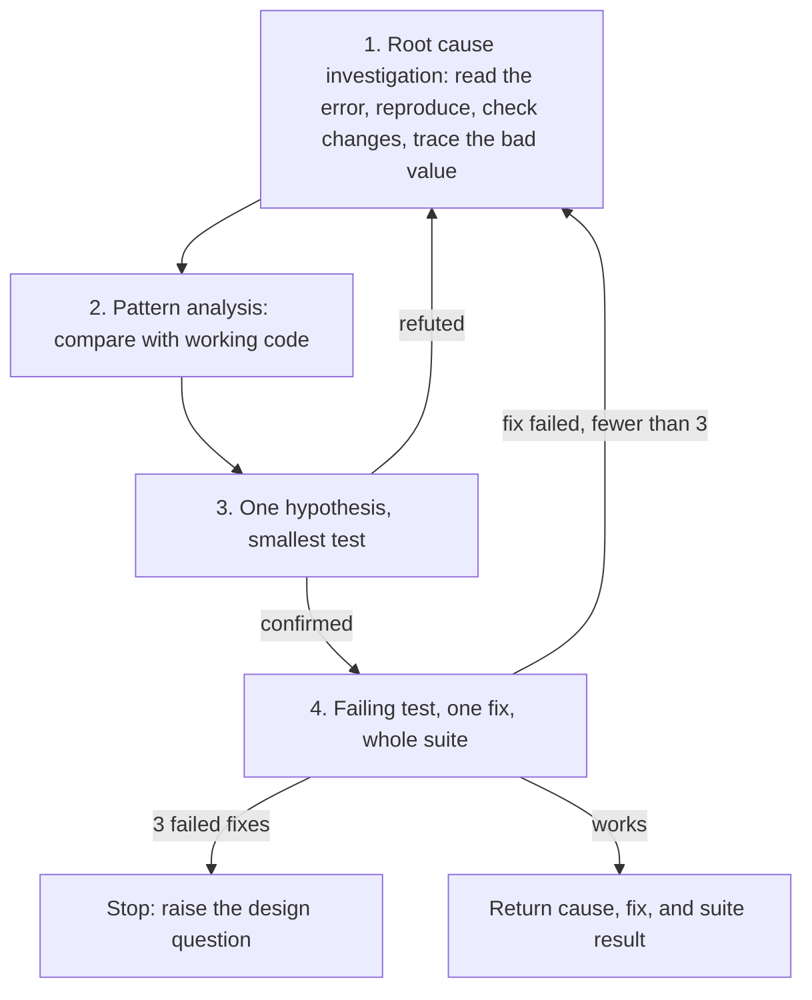

# debug

*English · [Polski](README.pl.md)*

## What

`debug` is a systematic debugging discipline for any bug, failing test, build failure, or unexpected behavior. It requires a confirmed root cause before any fix, and works in four phases: root cause investigation, pattern analysis, one tested hypothesis, and a fix proven by a failing test.

## Why

A fix proposed before the cause is known is a guess, and a guess that silences the symptom hides the defect. Investigating first is faster than a chain of fixes that cannot be told apart. The skill also sets a stop rule: after three failed fixes the problem is treated as a design question for the user, not as a reason for a fourth attempt.

## What it is not

It is not a debugger and adds no tooling or files. It does not verify facts (that is `cove`) and does not harden a strategy (that is `temper`); both are optional steps it points to where they help.

## Process

Optional steps: `cove` checks the factual claims a diagnosis rests on, and `temper` pressure-tests a fix that changes a design or contract. The test in phase 4 follows the `tdd` skill.

## How to use

Invoke it as a skill with a natural request ("debug this failing test", "find the root cause"), or by name: `adhoc-sdlc:debug` in Claude Code, `$debug` in Codex.

## Source

The method is adapted from the `systematic-debugging` skill of a public skill collection; the wording here is the repository's own.
