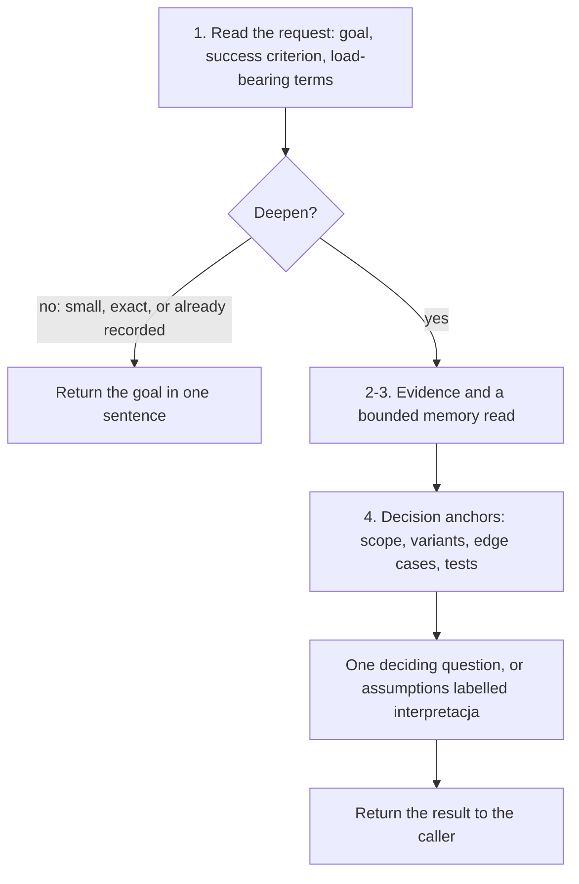

# intention-hardening

*English · [Polski](README.pl.md)*

## What

`intention-hardening` is a planning gate that hardens the user's intent before a
plan is written. It states the goal and the success criterion, names the
load-bearing terms with their meaning in this project and the source of that
meaning, surfaces interpretations, and asks only the question that decides the
result.

## Why

CoVe checks facts and Temper checks strategy, but nothing checked how the request
itself was read. A term narrowed without a word, or a scope widened past what the
user asked for, is cheapest to catch before the plan is accepted.

## What it is not

It does not plan, verify facts, or write anything. It returns its result to the
caller, which records it in sections that already exist (the adhoc-sdlc plan, or
the FORGE workspace context). It is not `/forge:harden`, which reports on a
workspace after it is finished.

## Process

1. Read the request: goal in one sentence, how success is recognised, and each
   load-bearing term with its project meaning and source; name every narrowing or
   widening of the user's words.
2. Treat binding decisions, run records, and handoff warnings as evidence; treat a
   memory hit as background until its entry or a source confirms it.
3. Spend one bounded memory read, then ask instead of searching further.
4. Settle the decision anchors that matter: scope, variants with a recommendation,
   edge cases, test strategy.

When the user says "don't ask", the request is still read and every interpretation
becomes an explicit assumption. Intent corrections made in dialogue are labelled;
the generalisable ones are returned as memory candidates, never written by the skill.

## Where it sits

`intention-hardening` runs first: it settles what is wanted, then `cove` checks the
facts and `temper` the strategy. It is called by `/adhoc-sdlc:plan` and by FORGE
`/forge init`: the FORGE init guide calls it before `cove` and `temper` and stops
with an explicit message when the plugin or a skill of an enabled mode is missing,
and continues only with the operator's consent.

## More detail

See `SKILL.md` for the agent-facing instructions, including the depth conditions
and the output shape.

## Author

Daniel Grabowski <daniel.grabowski@faktoria.io>
