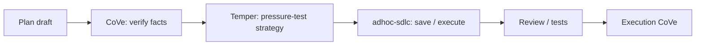

# temper

*English · [Polski](README.pl.md)*

## What

`temper` is a Harness strategy hardening gate. It pressure-tests a plan, an
architecture, or an implementation direction by looking for concrete failure
modes before the strategy turns into code.

## Why

Use it when a plan looks plausible but the cost of being wrong is high. The goal
is not to make the plan bigger; the goal is to make it survivable. Every
meaningful risk ends one of three ways: the plan changes to close it, the risk
is accepted with a stated reason, or the concern is rejected as speculative
(or sent back to CoVe when it depends on an unverified fact).

## What it is not

`temper` does not verify facts, review code line by line, or grow the feature
beyond the plan's goal. It is one tool among several:

- CoVe checks whether a claim is true.
- Temper checks whether the strategy survives realistic failure modes.
- Review and tests check the implementation.
- `adhoc-sdlc` keeps the plan, journal, resume path, and history.

## Where it sits in the Harness

`temper` runs after factual verification and before execution.



## How to use it

There is no `/temper` command. Invoke it two ways:

- as a skill, with a natural request such as „harden this plan before execution",
  „pressure-test this strategy", or „find the failure modes here";
- through the `strategy-temper` quality gate in `/adhoc-sdlc:plan`, which runs the
  same failure-mode pass after Plan CoVe and before the plan is saved.

When run inside `/adhoc-sdlc:plan`, the result is written into the plan body as
`## Tempered Risks` and `## Accepted Risks`, with the fixes already folded into
the plan rather than left as a separate to-do list. A fix stays within the plan's
goal; a change that would add behavior or scope beyond it is listed under
`Operator options` (with a reason and its cost) for the operator to decide, and an
option not taken is recorded under `## Accepted Risks`.

## Integration with adhoc-sdlc

See [integration/adhoc-sdlc-integration.md](integration/adhoc-sdlc-integration.md)
for the Phase 0 gate, the `## Mode` key, the planning run order, and the history
angles this unlocks. For a full pass, see [examples/sample-output.md](examples/sample-output.md).

## Installation

`temper` ships inside the `adhoc-sdlc` plugin for both Claude Code and Codex, so
installing that plugin installs this skill too. To use it standalone, copy the
`temper/` directory into your runtime's skills directory; the minimal structure is:

```text
temper/
  SKILL.md
  README.md
  integration/
    adhoc-sdlc-integration.md
  examples/
    sample-output.md
```

## Author

Daniel Grabowski <daniel.grabowski@faktoria.io>
